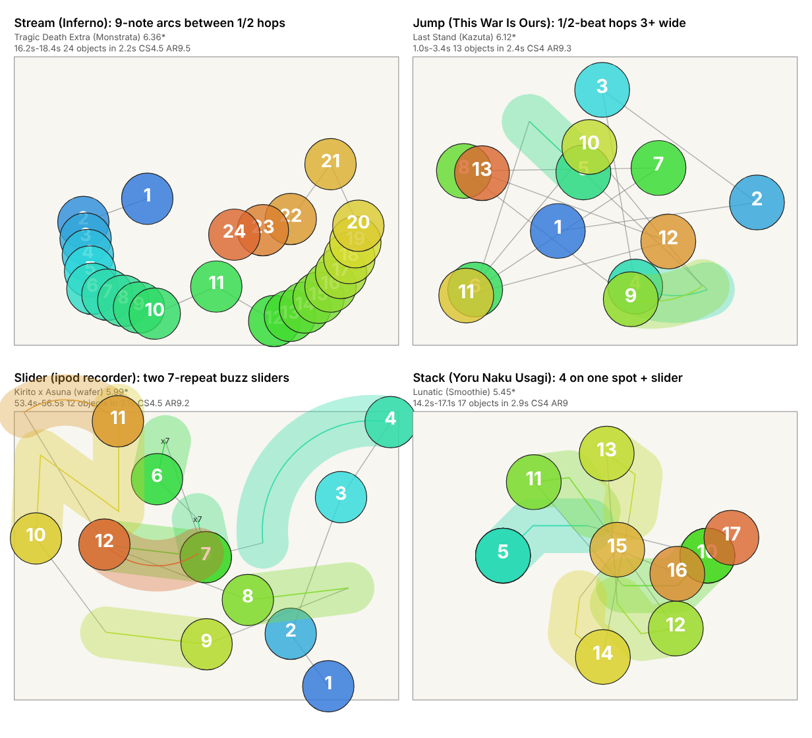

# Balanced

A Balanced map mixes streams, jumps and sliders in one difficulty and changes the mix with the music, section by section: calm verses, intense choruses, and no single technique running the whole song. In the generator this is the "Balanced mix (all styles)" option (params key `mix`, which picks a different preset for each section of the song) and the single `balanced` preset (one preset for the whole map). All numbers below were measured on human reference maps of 4.5 stars and up; the data is in [data/balanced.json](data/balanced.json).

## What it feels like

At the star ratings measured here (4.59 to 6.58) a Balanced map is mostly a slider-and-hop map with short bursts, not a stream map. In the three bands the median share of objects that are sliders is 49%, 34.7% and 35.1%, and the median share of objects inside streams is 12.5%, 28.5% and 28%. In the examples I read you spend most of the time on a repeating phrase: a circle on the beat, two to four circles at half-beat spacing (the "1/2 hops"), then a slider that you hold for about a beat before the next phrase starts about half a beat later. Every map in the set is 190-200 BPM except Yoru Naku Usagi wa Yume o Miru, which uses 11 different tempos between 85 and 200 BPM. At 195 BPM (Inferno, beat length about 308 ms as read from the file) a half-beat hop is about 154 ms, so a run of 1/2 hops is about 6.5 taps per second, and a 1/4 stream is about 13.

When mappers use it: in the examples I read the map is slider-heavy in some stretches and hop-heavy in others, and the denser stretches tend to line up with the chorus (kiai, the flagged climax). I checked the kiai flags with a one-off script that uses the analyzer's parser (these ratios are not in data/balanced.json): in 8 of the 10 reference maps that have kiai flags, the object rate inside kiai is higher than outside it. The ratio is about 1.15 to 1.7 times in seven of them (for example Kakushigoto [CRN] about 386 objects/min inside kiai versus 226 outside, Judgement about 295 versus 230) and slightly below 1 in two (NiNo's Insane about 231 versus 240, Lunatic about 258 versus 270). The tenth, Last Stand, shows about 352 versus 123, but it is a 57-second cut where kiai covers 48 s, so I do not trust that ratio. The six maps of Sent from my ipod recorder and Inferno have no kiai flags, so I could not test them this way.

What makes it hard, in the order I would rank it from the data and examples:

1. Aim on wide half-beat hops. Mean jump distance is 1.26-2.05 circle widths (p10-p90) at 4.5-5.5 stars and 2.13-2.88 at 5.5-6.5, and the 90th-percentile hop is 3.39-4.21 circle widths in the upper band, with 27-45% of turns sharp (see the table).
2. Switching between holding and tapping. A slider closes most phrases and the next head follows half a beat after it, so the hand has to release, hop and start the next burst quickly.
3. Occasional long runs in the loud parts. Most runs are 5 or 9 notes, but the examples include 23- and 25-note spaced streams (Judgement) and a 31-note stream with the notes almost on top of each other (Lunatic), see "Signature patterns".
4. The finale. The longest uninterrupted tapping stretch in the set is 36.3 s (Smokeman's Absolution), and in the Kanzen Kankaku Dreamer maps and Kakushigoto [CRN] the longest stretch falls in the last chorus, see "Pacing and breathers".

## Measured profile

Source: [data/balanced.json](data/balanced.json), made with `tools/style_profiles.py` from the maps in "Reference set". Each cell is **p10 / p50 / p90** (the value that 10%, 50% and 90% of the maps in that star band are below). Distances are in circle widths, from where the cursor leaves one object to the next head. "Sharp turn" means the cursor reverses hard (turn angle near 180 degrees = straight back). "Slider repeat" is the share of sliders that have a reverse. Buzz and kick sliders are counts per whole map, not rates, and maps differ in length, so compare them loosely. A single value in the 6.5+ column means the band holds one map (two files of it), so there is no spread to show.

| Metric (p10 / p50 / p90) | 4.5-5.5 stars | 5.5-6.5 stars | 6.5+ stars |
|---|---|---|---|
| Maps / mapsets | 6 / 5 | 10 / 7 | 2 / 1 |
| Star range in band | 4.59-5.45 | 5.83-6.41 | 6.58 |
| Objects per minute | 202 / 236 / 243 | 242 / 279 / 341 | 287 |
| Stream % of objects | 4 / 12.5 / 20 | 9.5 / 28.5 / 51.6 | 28 |
| Stream run length, median (notes) | 5 / 5 / 5 | 5 / 6 / 9 | 5 |
| Stream run length, longest (notes) | 5 / 5 / 9 | 9 / 17 / 21 | 18 |
| Stream spacing (circle widths) | 0.19 / 0.27 / 0.56 | 0.28 / 0.46 / 0.63 | 0.42 |
| Jump distance, mean (circle widths) | 1.26 / 1.8 / 2.05 | 2.13 / 2.41 / 2.88 | 2.39 |
| Jump distance, 90th pct (circle widths) | 2.33 / 2.88 / 2.99 | 3.39 / 3.77 / 4.21 | 3.79 |
| Sharp-turn % | 34.7 / 40.9 / 44.7 | 27.4 / 32.6 / 44.1 | 31.1 |
| Sliders % of objects | 39.7 / 49 / 54.2 | 20.7 / 34.7 / 49.4 | 35.1 |
| Slider repeat % | 4.2 / 7 / 11.3 | 0 / 5 / 8.7 | 0 |
| Buzz sliders (count per map) | 0 / 0 / 1 | 0 / 0 / 1 | 0 |
| Kick sliders (count per map) | 0 / 5 / 18 | 0 / 5 / 13 | 0 |
| Stack % | 2.9 / 8.7 / 10 | 0 / 4.8 / 9.3 | 14.2 |
| Odd-rhythm % | 0.3 / 0.9 / 1.6 | 0.3 / 1.1 / 2.7 | 4.2 |
| Longest tapping stretch (s) | 4.7 / 10.2 / 18.8 | 8 / 24 / 29.6 | 34.4 |
| Longest fast-tap stretch (s) | 0 / 1 / 1 | 2 / 4 / 8 | 4 |

How to read this honestly:

- I did not drop any requested row for being all zero: no row is zero in every band. The nearest is buzz sliders: the median is 0 in all three bands, and only 4 of the 16 distinct maps have any (Kirito x Asuna 4, Another Yui 4, Insane Agil 1, Kakushigoto [Insane] 1; per-map values from `metrics.json`). The 6.5+ column is 0 for slider repeats, buzz and kick sliders because that one map has none.
- The bands are thin. 4.5-5.5 has 6 maps from 5 mapsets. 5.5-6.5 has 10 maps from 7 mapsets, but Kakushigoto [Insane] and [Insane AR10] are the same notes with a different approach rate (I checked: identical hit objects and timing), so that map counts twice. 6.5+ is one map, Kakushigoto [CRN], also counted twice ([CRN] and [CRN-AR10-]), so its column is one data point.
- The Balanced label covers very different maps. In 5.5-6.5 the upper end of stream % (51.6) and of objects per minute (341) comes from the two Inferno Extras (Excruciating Extra 51.6% stream, Tragic Death Extra 51.7%), which behave more like stream maps than the rest. The lower end comes from maps that are mostly sliders and hops: stream % 9.5 is Smokeman's Absolution (Kanzen Kankaku Dreamer) and jump mean 2.13 is Kirito x Asuna.
- The mean share of 10-second timeline windows by type (from the same JSON): in 4.5-5.5 sliders (L) 0.55, bursts (B) 0.22, mixed (m) 0.12, jumps (J) 0.10, streams (S) 0.01, rests 0.01. In 5.5-6.5 jumps 0.38, sliders 0.29, streams 0.16, bursts 0.10, mixed 0.07, rests 0.01. In 6.5+ jumps 0.48, sliders 0.22, streams 0.13, bursts 0.09, mixed 0.04, rests 0.04. So the lower band is a slider map with bursts, and jump windows take over as stars go up.
- Approach rate is 9 in the 4.5-5.5 band (p10 and p90), 9-9.5 at 5.5-6.5; circle size is 3.7-4.0 and 3.6-4.5; overall difficulty 7-8.5 and 7-9.3 (p10-p90).

## Signature patterns

What I saw by reading excerpts of the raw maps (a dump of every object with its gap in beats and its distance in circle widths) and the timeline strings. Statements marked "in the examples I read" are my reading of a handful of maps, not a measured statistic. All times are seconds into the song. The picture shows four patterns from different maps:  Stacked circles are drawn on top of each other in the picture, so in the bottom-right panel you see only the last circle (the slider) of each stack and the numbers of the circles under it are hidden.

**1. The basic phrase: a step, 1/2 hops, a closing slider.** In the examples I read (Judgement, Kowari's Insane, NiNo's Insane, Kakushigoto [Insane]) the bulk of the map is one shape repeated every 2 to 4 beats: a circle one beat after the previous object, then 2 to 4 circles each half a beat apart, then a slider. In Judgement 11.9-18.6 s the hops are 2.1 to 4.2 circle widths (apart from one 1/4 burst at 16.8 s) and the closing slider is half a beat or one beat long. The same shape in NiNo's Insane (4.85 stars, 14-50 s) uses hops of about 1.1 to 1.2 circle widths, which is why that map's mean jump distance is only 1.26. So the way a mapper scales this pattern with stars is the spacing. Mean jump distance per map (from `metrics.json`): 1.26 in NiNo's Insane (4.85 stars), 2.05 in Kowari's Insane (5.02), 2.35 in Kakushigoto [Insane] (6.4), 2.67 in Judgement (6.34), 2.88 in Last Stand (6.12).

**2. Chains of short sliders, one per beat.** A slider about half a beat long, then a hop of 1.1 to 3.5 circle widths to the next one, repeated. Examples: Kakushigoto [Insane] at 31-35 s, Lunatic at 15.5-16.5 s (four sliders 2.5 to 2.75 circle widths apart, one per beat). The longest slider-only passage I read is Judgement 32.4-51.1 s, about 19 seconds that are almost only sliders (28 of 47 are one-beat 170 px sliders, 17 are half-beat 85 px sliders, 2 are circles) with the next head 1.5 beats after the last one, hops of 1.1 to 5.3 circle widths (most are 1.3 to 3.7). In the single-slider stretches of that passage you hold a key for about two thirds of each cycle.

**3. Phrases end on a long slider.** In Judgement, Kowari's Insane and Lunatic the common end of a phrase is a one-beat slider (128 to 220 px) and the next head comes half a beat after it (1.5 beats head to head). It works as a small breath, and the hop that follows is usually 1 to 3 circle widths.

**4. Streams are mostly bursts.** Median run length is 5 or 6 notes in every band (the 5-note burst is exactly one beat of 1/4 notes), with 9-note runs common. In a one-off count over the 16 distinct maps (the analyzer's stream definition, every run of 4 or more notes; not in data/balanced.json) there are 342 runs: 176 are 5 notes (51%), 73 are 9 notes (21%), 36 are 7 notes, 15 are 17 notes, 11 are 6, 8 are 4, 7 are 13, and the rest are 10, 11, 15, 18, 21, 23, 25 and 31 notes (a handful each). So 79% of runs (271 of 342) are 5, 9, 13 or 17 notes, a whole number of beats of 1/4 notes plus the starting note. Three kinds of long stream appear:
- Curved 1/4 arcs of 9 notes, spacing about 0.29 to 0.57 per arc (0.29-0.51 in Excruciating, 0.33-0.57 in Tragic Death), repeated every 3 beats between 1/2 hops: Inferno at 15.5-21.6 s has seven of them in a row (63 notes in about 6 s). Both Excruciating Extra (5.83 stars) and Tragic Death Extra (6.36 stars) play this same passage with the same timing; most of the arcs are 0.29 wide in Excruciating and 0.33 wide in Tragic Death, and one arc per passage is wider (0.51 and 0.57), so here the higher difficulty only widens the spacing slightly (top-left panel of the picture).
- Spaced streams: Judgement has a 23-note run at 70.3 s (spacing about 0.71 circle widths) and a 25-note run at 151.2 s (about 0.6), each preceded by 1/2 hops. The 25-note run ends on a 42 px quarter-beat slider, then a 3.7-circle-width hop to a second 42 px slider, then a 4.6-circle-width hop.
- A compact "stack stream": Lunatic at 102.0 s plays 31 notes about 0.11 circle widths apart, so the circles nearly overlap and the aim cost is close to zero. It comes about 2 seconds after a chain of six kick sliders (98.4-99.9 s, one per beat, 1.7 to 3.4 circle widths apart).

**5. Stacks come in three forms.** Stack % is 2.9-10 at 4.5-5.5 stars.
- A stack burst: 3 or 4 circles at 1/4 spacing on one spot, finished by a slider that starts on the same spot. Lunatic at 14.4 and 15.0 s plays two of these 2.26 circle widths apart (bottom-right panel; the circles under the slider are hidden). Lunatic uses this form again and again in the first minute I read (1-60 s), which fits its stack % (13.4) and its timeline full of B windows.
- A stacked pair at half-beat spacing: after a hop, a second circle (or a slider head) sits on the same spot as the object before it, then the next hop follows (NiNo's Insane, Kowari's Insane, Kirito x Asuna).
- A slow near-stack line: Judgement 27.1-31.5 s has 15 circles one beat apart, 12 of the 14 hops about 0.25-0.41 circle widths, with two bigger hops (2.0 and 4.5). It is a slow pad right before the slider passage in item 2.

**6. Kick sliders and 3-repeat sliders as connectors.** Kick sliders (exactly one reverse, short) are 0 / 5 / 18 per map (p10 / p50 / p90) at 4.5-5.5 stars. In Agonizing Insane (Inferno) they come in groups of three, one per beat (1.6, 1.9, 2.2 s, then 3.5, 3.8, 4.1 s, then 5.3, 5.6, 5.9 s), and Lunatic uses a chain of six (see item 4). Short sliders with two reverses (a 3-slide slider, 0.75 beat) also appear in several maps (Kakushigoto [Insane], NiNo's Insane, Another Yui, Kowari's Insane), often after a short burst. The analyzer does not count these as kick or buzz.

**7. Buzz sliders are rare and clustered.** Only 4 of the 16 distinct maps have any. In the VINXIS mapset all three difficulties put a buzz slider at the same moment, 44.2 s, and the repeat count follows difficulty: 14 repeats (Insane Agil, 4.59 stars), 29 (Another Yui, 5.36) and 30 (Kirito x Asuna, 5.99). The slider is 7 to 18 px long, so it plays like a circle you hold and shake. Kirito x Asuna also has 7-repeat buzz sliders in pairs at 54.3 and 54.6 s, followed by sliders one beat apart (bottom-left panel). Kakushigoto [Insane] has an 11-repeat buzz at 11.7 s that lasts 2.75 beats and is followed by a 2.25-beat gap, then five circles at half-beat spacing about 1.0 circle width apart. So the buzz slider is a held moment: in the Kakushigoto example it is followed by a gap, but in Kirito x Asuna the next object comes about 0.1 beat after its end, so it is not a rest there.

**8. How jump direction changes.** Sharp-turn % is 34.7-44.7 (4.5-5.5) and 27.4-44.1 (5.5-6.5), and straight-on moves are only about 22-29% at the medians (straight % medians 23.7, 21.9 and 28.8), so most hops change direction. In the examples I read the flow is angular and back-and-forth: positions are reused, which makes the cursor ping-pong between a few spots. In the jump panel (Last Stand 1.0-3.4 s) 13 circles hit a small set of positions (objects 8 and 13, 6 and 11, 4 and 9, 5 and 10 sit on top of each other), and the hops are about 3.0 to 4.0 circle widths. Inferno 11.9-14.8 s (Tragic Death Extra) repeats the same screen positions in a 1/2-hop figure, for example (273,104) three times, with hops of 1.3 to 4.8 circle widths. Stream parts bend gently in contrast: the mean turn inside streams is 8.2 degrees at p50 for 4.5-5.5 (short bursts are nearly straight lines) and 20.4 for 5.5-6.5.

**9. Rests and sections.** Rest windows ('.' in the timeline) are few: Kakushigoto [Insane] and [CRN] have one around 70 s (a spinner at 70.8-70.9 s), Kowari's Insane has one in the 100-110 s window; the mean share of rest windows is 0.01 / 0.01 / 0.04. More often the map changes character by section rather than stopping. Examples of the timeline strings (one letter per 10 s): Tragic Death Extra `SSSBJmLSS` (stream, burst, jump, mixed, slider, stream), Agonizing Insane `LBBmLmLBB`, Kakushigoto [Insane] `JmmLJJJ.mJLJJJSSLSJJLJJS`, Judgement `JJJLLLBJJJJLLLBJJJJJJJJJJ`, Lunatic `BLBLBBBBBLSmBmBBmLLLLL` (note the L-heavy last 50 seconds). Spinners work as short breaks and appear in 8 of the 16 maps (Kakushigoto [CRN] has 4; NiNo's Insane and Mousou's CRN's Extra 2 each; Kakushigoto [Insane], Kirito x Asuna, Lunatic, Yoru Naku's CRN's Extra and Kowari's Insane 1 each); count from `metrics.json`.

## Pacing and breathers

Your pacing rule is that a player should not spam-tap for longer than about 10 to 15 seconds, and sliders and buzz sliders give a break to catch up (as in Honesty). Here is what the data says, with the measurement definitions first:

- Longest tapping stretch = seconds between rests, where a rest is a gap of at least 1.45 beats or a slider held at least 0.97 beat. It counts 1/2-beat hops as tapping.
- Longest fast-tap stretch = consecutive 1-second bins with at least 8 key presses (real stream-speed tapping).

What the human maps do:

- By the strict "tapping stretch" measure, the maps break your rule. In the 16 distinct maps, 10 have a stretch longer than 15 s (18.0 to 36.3 s) and 6 stay at or below 14.4 s (4.7 to 14.4). Median longest stretch per band: 10.2 s (4.5-5.5), 24 s (5.5-6.5), 34.4 s (the one 6.5+ map). The p90 of the lower band is 18.8 s.
- By the fast-tap measure, they keep close to your rule: every map has a longest stream-speed stretch of 8 s or less (p90 8 s in 5.5-6.5, none over 10 s in the per-map data). The two Inferno Extras are the ones at 8 s.
- Where the long stretches are, in the examples I read. A per-map check with the analyzer's definitions (one-off script, start time = where the stretch begins) shows the longest stretch of the three Kanzen Kankaku Dreamer maps starting at about 208-210 s, which is the last chorus (kiai flagged from about 208 s to the end): Kowari's Insane 30.3 s, Judgement 29.2 s, Smokeman's Absolution 36.3 s. Kakushigoto [CRN] has 34.4 s from 190 s (kiai 190-224 s) and two more of 28.4 s at 42 s and 111 s, both of which run into a kiai section (52-73 s and 120-139 s). Mousou's CRN's Extra has 27.1 s at 130 s (kiai 118-158 s) and 29.6 s at 27 s, which ends just before its first kiai (58 s). Judgement has a second long stretch of 25.9 s from 151 s (kiai 154-173 s). In the two Inferno Extras the longest stretch (26.2 and 26.3 s) starts at 11 s, right after the intro sliders spaced 3 beats apart (9-10.8 s), and the next longest is 12 to 13 s; these maps have no kiai flags. So in most examples the long stretches run through a chorus or the finale, but not all of them (the 27 s stretch in Mousou's CRN's Extra and the Inferno ones do not).
- What the long stretches are made of: in the Kanzen maps (stream % 4, 9.5 and 13.3) nearly all of it is 1/2-beat play with short sliders, not stream. In the Inferno Extras (stream % about 51.6) it includes the 9-note arcs, which is why those two reach 8 s of fast tapping. At 4.5-5.5 stars the total fast-tap time per map is small (p50 3 s, p90 4 s). That is the main reason the strict measure looks much worse than the fast-tap measure.

What they do instead of resting, in the examples I read:

1. A closing slider on nearly every phrase (item 3 above): you hold for 0.5 to 1 beat, and the analyzer counts a hold of 0.97 beat or more as a rest, so the slider-only passage in Judgement (32.4-51.1 s) resets the counter at each one-beat slider (the half-beat sliders in it are too short to count as rests).
2. Gaps of 2 to 5 beats before a new phrase: Kakushigoto [Insane] at 13.2 s (5 beats from the buzz head), 15.6 s (4 beats), 21.8 s (4.5 beats); Last Stand 30.8-33.4 s plays three single circles and a slider 2 to 3 beats apart after a long burst-and-hop section (1-26 s).
3. Slider-only moments: Lunatic 20.4-22.8 s is four one-beat sliders, each head 2 beats after the previous one (about 0.6 s apart).
4. Buzz sliders (item 7), kick-slider chains (item 6) and spinners (item 9).
5. Switching technique by section: the timeline strings show L (slider) windows between the J (jump), B (burst) and S (stream) windows in most maps (examples in item 9); the exception is Excruciating Extra, which has no L window at all.

Where the human maps break your rule: the last chorus of the Kanzen Kankaku Dreamer maps (about 30 to 36 s of tapping from 208-210 s), Kakushigoto [CRN] from 190 s (34.4 s) and Mousou's CRN's Extra at 27 s and 130 s. None of these has a stream-speed stretch longer than 8 s, but they do ask for 30 s or more of continuous tapping, mostly on 1/2 hops with short sliders that are never held for 0.97 beat or more. Per map there are up to 3 stretches over 15 s (Kowari's Insane and Kakushigoto [CRN] have 3 each; per-map `tap_over_15s` in `metrics.json`). For a generator, a rule that fits both your idea and the data: keep the fast-tap stretch at 8 s or less (every map did), put a slider held about one beat or a gap of 1.5 beats or more at least every 15 s in verses, allow longer stretches (up to about 36 s, at most about 3 per map) only in the loudest sections, and use a buzz or kick slider as a connector rather than a gap. The "every 10 to 15 seconds" interval is your rule, not something these maps follow by the tapping-stretch measure.

## Targets for the generator

Measurable targets for a Balanced map, taken straight from the p10-p90 ranges above. The 4.5-5.5 range comes from 6 maps and the 5.5-6.5 range from 10 maps (9 distinct), so treat ends of the ranges as soft. There is only one map at 6.5 stars and up (6.58), so no range exists there: do not extrapolate beyond about 6.6 stars from this data.

- 4.5-5.5 stars
  - Objects per minute 202-243; stream % 4-20; run length median 5, longest 5-9 notes; stream spacing 0.19-0.56 circle widths.
  - Jump distance mean 1.26-2.05, p90 2.33-2.99 circle widths; sharp turns 34.7-44.7%.
  - Sliders 39.7-54.2%; slider repeat 4.2-11.3%; buzz sliders 0-1; kick sliders 0-18; stacks 2.9-10%; odd rhythm 0.3-1.6%.
  - Longest tapping stretch 4.7-18.8 s; longest fast-tap stretch 0-1 s.
- 5.5-6.5 stars
  - Objects per minute 242-341; stream % 9.5-51.6; run length median 5-9, longest 9-21 notes; stream spacing 0.28-0.63.
  - Jump distance mean 2.13-2.88, p90 3.39-4.21; sharp turns 27.4-44.1%.
  - Sliders 20.7-49.4%; slider repeat 0-8.7%; buzz sliders 0-1; kick sliders 0-13; stacks 0-9.3%; odd rhythm 0.3-2.7%.
  - Longest tapping stretch 8-29.6 s; longest fast-tap stretch 2-8 s.
- 6.5+ stars (one map, centre point only)
  - Objects per minute about 287; stream % 28; longest run 18; stream spacing 0.42.
  - Jump distance mean 2.39, p90 3.79; sharp turns 31.1%; sliders 35.1%; stacks 14.2%; odd rhythm 4.2%; no buzz, kick or repeat sliders.
  - Longest tapping stretch 34.4 s; longest fast-tap stretch 4 s.
- All bands (from the examples I read and the kiai check, not from the table): build phrases as a step, 2-4 half-beat hops and a closing slider; make the chorus about 1.15 to 1.7 times denser (objects per minute) than the verse, which is what 7 of the 9 maps with a trustworthy kiai ratio did (8 of 10 if Last Stand's 57-second cut is counted); keep fast-tap stretches at 8 s or less; end bursts on a beat (5, 9, 13 or 17 notes) with a short slider; use buzz sliders rarely (median 0 per map; 4 of the 16 maps have any).

Check a generated map against these numbers:

```
python tools/analyze_maps.py <file.osu>
```

## Reference set

Used (4.5 stars and above, standard mode, labelled "balanced" by the user, minus the excluded maps): 18 difficulty files from 7 mapsets, which is 16 distinct maps because two Kakushigoto maps appear twice with a different AR. Titles, artists, mapset creators and star ratings only; the files stay local (references/ is git-ignored).

| Song (artist) | Mapset creator | Difficulties used (stars) | Band |
|---|---|---|---|
| Kakushigoto (yuikonnu) | murasaki_sk | Insane (6.4), Insane AR10 (6.4), CRN (6.58), CRN-AR10- (6.58) | 5.5-6.5 and 6.5+ |
| Sent from my ipod recorder (VINXIS Edit) (VINXIS) | wafer | Osu's Insane Agil (4.59), Osu's Another Yui (5.36), Kirito x Asuna (5.99) | 4.5-5.5 and 5.5-6.5 |
| Inferno (9mm Parabellum Bullet) | Monstrata | Agonizing Insane (4.97), Excruciating Extra (5.83), Tragic Death Extra (6.36) | 4.5-5.5 and 5.5-6.5 |
| Mousou Kajitsu (Nanaki feat. GUMI) | Natsu | NiNo's Insane (4.85), CRN's Extra (6.12) | 4.5-5.5 and 5.5-6.5 |
| Yoru Naku Usagi wa Yume o Miru (UNDEAD CORPORATION) | Smoothie | Lunatic (5.45), CRN's Extra (6.41) | 4.5-5.5 and 5.5-6.5 |
| Kanzen Kankaku Dreamer (ONE OK ROCK) | Nevo | Kowari's Insane (5.02), Smokeman's Absolution (6.33), Judgement (6.34) | 4.5-5.5 and 5.5-6.5 |
| This War Is Ours (The Guillotine II) (Cut Ver.) (Escape the Fate) | Kazuta | Last Stand (6.12) | 5.5-6.5 |

Not used, and why:

- Excluded as mislabeled by the audit (5 maps). From `metrics.json`: Inferno [The Eclipse] (7.55 stars; stream 62.8% of objects, longest run 105 notes) and [Tortured Soul Extra] (6.88; stream 58.3%, longest run 101) are stream maps; Mousou Kajitsu [Climax] (6.75; 14 of its 16 timeline windows are J, stream 24.3%, longest tapping stretch 40.8 s) reads as a jump map; Tatsh IMAGE -MATERIAL- Version 0 [Envision] (6.47; sliders 60.9% of objects, 36 of its 42 timeline windows are slider-heavy) reads as a slider map. For Kanzen Kankaku Dreamer [Reform's Extra] (5.51; stream 3.4%, sliders 48.5%) I cannot see a reason in the numbers alone, because Kowari's Insane (5.02; stream 4%, sliders 49%) looks similar and was kept; I followed the audit. Excluding the Tatsh mapset leaves it with no maps in this set.
- Below 4.5 stars (not representative of the style): Inferno Painfully Easy (1.74), Blistering Normal (2.27), Traumatized Hard (3.51); VINXIS Normal Klein (2.67), jasontime's Hard Liz (3.32); Mousou MZV's Normal (2.23), Doyak's Advanced (3.06), Gaia's Hard (3.86); Yoru Naku Usagi Lanturn's Easy (1.89), Normal (2.11), Hard (3.34); Kanzen Kankaku Dreamer Akitoshi's Normal (2.57), Agatsu's Hard (3.87).
- Two Yoru Naku Usagi difficulties (Midnaait's Muzukashii and Oni) have no entry in `metrics.json`; the analyzer only measures standard mode, so I did not use them.

Sample sizes and weaknesses: 16 distinct maps in 7 mapsets, bands of 6, 10 (9 distinct) and 1 (2 files). The bands contain 5, 7 and 1 mapsets, so a single mapset pulls a band: Kakushigoto is 4 of the 18 files, Kanzen Kankaku Dreamer 3, Inferno 3 and VINXIS 3. The songs run from 0.94 to 4.09 minutes (Last Stand is a short cut, the Kanzen maps are 4.09 minutes), so per-map counts of kick or buzz sliders are not comparable. p10-p90 on 6 or 10 maps is a rough range, not a distribution, and the 6.5+ numbers are one map. The kiai-density numbers in this doc come from a one-off script, not from `style_profiles.py`. Treat all of this as a first calibration to be rechecked when more Balanced maps are added, especially above 6.5 stars.

## See also

- [Instruction](../styles/Instruction.md)
- [Stream](stream.md)
- [Jump](jump.md)
- [Tech](tech.md)
