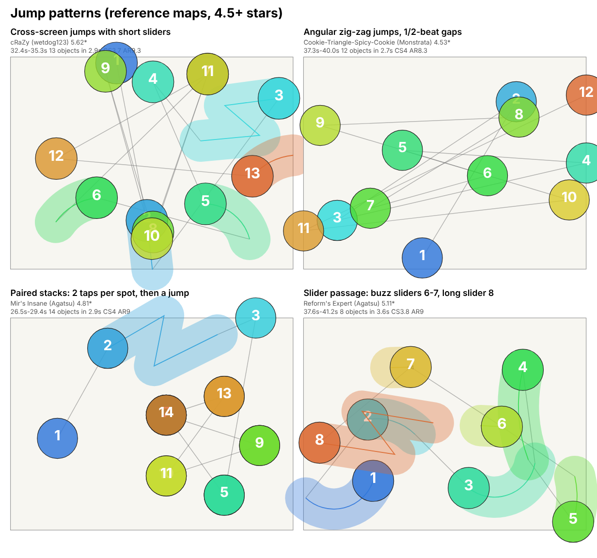

# Jump

A Jump map is built from circles placed far apart, so the cursor has to snap across the playfield from one note to the next instead of tapping fast. Most notes are half a beat or one beat apart and sit roughly 2 to 4 circle widths from the previous one, and the cursor usually turns sharply (120 degrees or more) at the next note instead of flowing on. Short sliders sit between groups of circles, stacks give a double or triple tap on one spot, and kick sliders add an occasional small snap. Streams are not part of the style: of the 47 reference maps used here, only 1 contains any.

This page is based on 47 human-made osu!standard difficulties of 4.5 stars and above (8 mapsets), measured with `tools/analyze_maps.py` and summarised with `tools/style_profiles.py`. The numbers are in [data/jump.json](data/jump.json). The generator style it documents is "Jump-focused" (params key `jump`).

## What it feels like

You are always moving and the notes arrive on a steady pulse. In the examples I read, a typical phrase is a group of 1 to 8 circles at half-beat spacing (Get Jinxed "Master" has one 12-circle run that includes quarter-beat stack taps), then a short slider, then a one-beat gap before the next group. Every circle is a new target across the screen from the last one, so the difficulty is aim and cursor speed, not tapping speed. The measured fast-tap stretch (8 or more key presses in a second) is 0 s at the 90th percentile in both main star bands.

Mappers use it on songs with a clear, steady beat, and in this set mostly on fast ones: the main BPM is 136 to 207 (one mapset changes down to 92.5), and 4 of 8 mapsets are labelled nightcore, sped-up or cut in their titles (PADORU is also only a 30-second excerpt). Half-beat and one-beat gaps together are 86.0% of the 10,362 gaps in the 47 maps (56.2% half-beat, 29.8% one-beat). The timeline strings (one letter per 10 seconds) show jump windows in 53% of windows at 4.5-5.5 stars and 64% at 5.5-6.5 stars, with slider-heavy windows making up most of the rest.

What makes it hard:

- **Distance.** The mean jump is 2.7 circle widths at 4.5-5.5 stars and 3.06 at 5.5-6.5 (medians). The longest jumps in a map (90th percentile) are 3.7 and 4.3 circle widths. Across the 47 maps the single longest jump per map has a median of 5.15 circle widths.
- **Direction changes.** The median map has 77.8% (4.5-5.5) and 82.5% (5.5-6.5) sharp turns (120 degrees or more). Straight-on turns (30 degrees or less) are about 1%. The cursor snaps back and forth rather than gliding.
- **Fast approach.** AR is 9.0 at the median for 4.5-5.5 stars and 9.3 for 5.5-6.5, so circles are on screen briefly and you read and aim at the same moment.
- **Density.** About 233 and 254 objects per minute (medians), with the busiest 10 seconds at 47 and 49 objects.

## Measured profile

All cells are p10 - p50 - p90 over the maps in that band (from `data/jump.json`). Jump distance is in circle widths. Bands with n below 5 are weak evidence: the 6.5+ band has a single map, so its column is one map's value, not a range.

| Metric | 4.5-5.5 stars | 5.5-6.5 stars | 6.5+ stars (n=1) |
|---|---|---|---|
| Maps / mapsets | 28 / 8 | 18 / 7 | 1 / 1 |
| Objects per minute | 180-233-261 | 190-254-272 | 296 |
| Busiest 10 s (objects) | 40-47-51 | 41-49-55 | 51 |
| Jump distance, mean | 1.93-2.7-3.16 | 2.23-3.06-3.43 | 3.43 |
| Jump distance, p90 | 3.04-3.71-4.3 | 3.81-4.3-4.62 | 4.43 |
| Jump distance, variation inside a map (cv) | 0.22-0.34-0.58 | 0.24-0.34-0.51 | 0.25 |
| Sharp turns (120 deg or more), % of turns | 36.8-77.8-90.8 | 51.6-82.5-92.5 | 91.6 |
| Straight-on turns (30 deg or less), % | 0-1.2-8 | 0-0.6-9.8 | 1.1 |
| Sliders, % of objects | 27.6-41.6-47.9 | 31.5-37.7-63.4 | 34.6 |
| Sliders shorter than 1 beat, % of sliders | 94.2-98.7-100 | 94.4-98.9-100 | 98.3 |
| Sliders with a repeat, % of sliders | 0-1.9-7.6 | 0-2.1-6 | 1.7 |
| Kick sliders per map | 0-0-5 | 0-0-4 | 2 |
| Buzz sliders per map | 0-0-0 | 0-0-1 | 0 |
| Stacks, % of objects | 0-3.8-10.7 | 0-2-6.3 | 5.1 |
| Odd rhythm (1/3, 1/6, 2/3, 3/4), % of gaps | 0-0-6.8 | 0-0-3 | 0.3 |
| Longest tapping stretch (s) | 4.6-9.2-18.7 | 4.6-8.6-14.5 | 6.7 |
| Longest fast-tap stretch (s) | 0-0-0 | 0-0-0 | 1 |
| AR | 8.8-9-9.2 | 9.2-9.3-9.4 | 9.4 |
| OD | 8-8.5-9 | 8.6-9-9.3 | 9.3 |
| CS | 3.4-4-4.2 | 3.5-3.8-4.3 | 4 |

Rows left out because they are zero at p10, p50 and p90 in every band: stream %, run length median and max, stream spacing, stream turn angle, and burst runs (3 to 7 notes; the only exception is Mir's Insane, with 2 burst runs). In other words, the typical Jump map has no 4+ note streams. The one exception is Mir's Insane (Chikatto Chika Chika, 4.81 stars): 3.2% of its objects are in stream runs (2 runs, longest 5 notes, spacing 0.28 circle widths). Only 2 of 47 maps have any fast-tap stretch at all (both 1 s).

Timeline shares (mean over maps): 4.5-5.5 stars jump 53%, slider-heavy 29%, mixed 11%, rest 7%; 5.5-6.5 stars jump 64%, slider-heavy 27%, mixed 3%, rest 6%; the one 6.5+ map is 86% jump and 14% slider-heavy.

Other measurements over the 47 maps (summed from `metrics.json`): slider shapes are 48.2% perfect-circle arcs, 34.8% straight and 17.0% bezier; 11 maps contain a spinner; 38 maps have at least one stack; 22 have at least one kick slider and 6 have at least one buzz slider. The 5.5-6.5 slider p90 of 63.4% is pulled up by three slider-heavy maps in that band: Xenon's Hi-Speed Expert (77.1%), Weedy's Extra (72.3%) and Rolniczy's Hi-Speed Expert (63.4%).

## Signature patterns



The picture shows four excerpts of 2.7 to 3.6 seconds from reference maps. Numbers are play order, blue is first and orange is last; grey lines are the cursor path. In the stack panel the two notes of a pair sit on the same spot, so only the later number is visible. Everything below that is marked "in the examples I read" is my reading of a few maps (excerpts of the raw maps and their timeline strings), not a statistic.

**Groups of half-beat circles, then a short slider, then a one-beat gap.** In the examples I read (Mekadon's Extra 20-45 s, Fearless Rockstar 40-62 s, Get Jinxed "Master" 5-50 s), the pulse is a group of 1 to 8 circles at 0.5 beat (Master has one 12-circle run that includes quarter-beat stack taps), then a slider that starts one beat after the last circle, then the next group. In Mekadon's Extra the groups are 1 to 4 circles with hops mostly 2.5 to 4.5 circle widths, and a 1.5-beat gap ends some phrases (7.5% of all gaps are 1.5 beats). In Fearless Rockstar the hops are mostly 3.5 to 5.4 circle widths, the biggest in the examples I read, with up to 8 circles in a row before a slider. Sliders are short: the median slide is 0.5 beat and 94 to 100% of sliders (p10 to p90) are under one beat.

**Spacing grows slowly and stays steady inside a phrase.** The variation of jump distance inside a map is a median cv of 0.34 in both bands, so hops do not change size randomly. In the one circle-only stretch I read (Cookie-Triangle-Spicy-Cookie, 16.2% sliders in the whole map, the lowest in the set), from about 31.4 s to the end (about 39 circles, all at half-beat except one 1-beat gap), hops start at 1.5 to 3 circle widths, sit near 3.5 for about a dozen hops, rise to 4 to 5, then finish at 6.5 to 7.8 (the map's longest jump is 7.79).

**Hard direction changes, few straight lines.** With 78 to 83% sharp turns and about 1% straight-on turns, the cursor mostly goes back across the screen. The zig-zag panel (Cookie-Triangle-Spicy-Cookie) shows it: the path crosses itself and returns to the same few areas. Linear flow versus circular flow is not measured separately by the tools, so I make no numeric claim about it.

**Stacks as a double or triple tap on one spot.** 38 of 47 maps have at least one stack, but the median is only 3.8% of objects (4.5-5.5 stars) and 2% (5.5-6.5). Seven maps have 10% or more: six from the PADORU mapset (Anzei's Another 15.2%, Rolniczy's Hi-Speed Expert 15.3%, Frontier's Expert 15.0%, FuJu's Expert 14.8%, Christmas Drift 13.5%, Light's Expert 10.7%) and Take Us To Vegas "Insane" (10.0%). In Anzei's Another (8-22 s) the stack is a circle followed by two more circles on the same spot at quarter-beat gaps (three taps without moving), usually just before a one-beat slider or a half-beat jump. In Mir's Insane (26.5-29.5 s, in the picture) it is a run of pairs: each spot is hit twice at half-beat spacing, then the cursor jumps about 2.4 circle widths to the next spot. In Kumocha's Expert (20-35 s) a kick slider is followed by a 2.5 beat gap and then a circle placed exactly on the slider's head.

**Kick and buzz sliders are accents, not the base.** 22 of 47 maps have at least one kick slider (short slider with one reverse); the median is 0 per map and the p90 is 5 and 4 in the two main bands. The most are in Weedy's Extra (15), Take Us To Vegas "Insane" (8), and Reform's Expert (Chikatto Chika Chika), Kuki's Expert and Kumocha's Expert (Determinate), with 5 each. Only 6 of 47 maps have any buzz slider (very short slider with many repeats), at most 4 in one map (Reform's Expert, Chikatto Chika Chika). In that map, in the picture's slider panel, two buzz sliders with 4 slides each (6 and 7) come after a chain of sliders one to 1.5 beats apart, followed by a long slider (8) that lasts about 3.75 beats (the next note comes 4 beats after its head). In Get Jinxed "Irrelvis' Diamond" the three buzz sliders have 6 to 8 slides and are 12 pixels long, at about 38.7 s to 39.3 s.

**Slider-led maps use sliders as the jump targets.** In Weedy's Extra (72.3% sliders), the sliders themselves are the half-beat jump targets, mostly 2 to 6 circle widths apart (1.1 to 5.8 in the stretch I read, 30-45 s), with 1.5-beat gaps appearing often between groups. Take Us To Vegas "Insane" (61.0% sliders) is a different slider-led case: sliders one beat apart, mostly 1.2 to 3.1 circle widths (median 2.3), with circles placed on the same spot as the neighbouring slider head (stacks of 2 or 3). With Xenon's Hi-Speed Expert (77.1%) and Rolniczy's Hi-Speed Expert (63.4%), these are the four most slider-heavy maps in the set; only 3 of the 47 maps are below 28% sliders.

**Streams are not the way these maps build intensity.** The only stream-like passage is Mir's Insane (4.81 stars), where the longest run is 5 notes at 0.28 circle widths. The three maps removed from this set (see Reference set) were the ones with real streams: they had runs of up to 19 notes.

## Pacing and breathers

The 10-15 second rule is about spam-tapping. Jump maps do not ask for that: the longest fast-tap stretch is 0 s at p90 in both main bands, and only 2 of 47 maps have any (1 s each). What they ask for is continuous aiming.

The longest tapping stretch (time between rests; a rest is a gap of 1.45 beats or more since the previous object ended, or a slider held for 0.97 beat or more) is:

- 4.5-5.5 stars: 4.6 s (p10), 9.2 s (median), 18.7 s (p90).
- 5.5-6.5 stars: 4.6 s (p10), 8.6 s (median), 14.5 s (p90).

So the median map stays inside the 10-15 second rule, but not all of them do. In the per-map numbers, 14 of 47 maps have a stretch longer than 10 s and 7 of 47 are longer than 15 s: Get Jinxed "Master" (43.0 s), Get Jinxed "Irrelvis' Diamond" (33.0 s), Take Us To Vegas "Extreme" (26.5 s), PADORU "FuJu's Expert" (21.8 s), Backstabber "skylaa's Extra" (19.1 s), Cookie-Triangle-Spicy-Cookie (18.7 s) and Bubblegum Bitch "Mekadon's Extra" (15.9 s). So human Jump maps do break the rule at the top end, about one map in seven by more than 15 s. These stretches are half-beat aiming at about 4 notes per second on average (233 to 254 objects per minute), not stream-speed tapping. Also, the maps run only 0.5 to 2.2 minutes, so the maxima are capped by map length.

In the 43 s stretch of "Master", the excerpt I read has a slider every beat or so (the map's median slider is 0.5 beat long, so the tool does not count them as rests), so the player is aiming constantly but gets a slider's worth of release between short groups. I read this as the nearest thing to the catch-up effect you described; it is not measured as a rest.

What the maps do instead of resting (note: the gap percentages below, 1-beat 29.8%, 1.5-beat 7.5% and over 2 beats 1.0%, are head-to-head times, so they include the length of a slider that sits between two notes):

- **The 1-beat gap after a slider.** 29.8% of all gaps are one beat, so the usual rhythm is a few half-beat circles, then a slider, then a slightly longer pause.
- **The 1.5-beat gap** at the end of a phrase (7.5% of gaps; about half a second at 180 BPM).
- **Longer gaps.** Only 1.0% of all gaps are longer than 2 beats. Examples in the excerpts: Reform's Expert (Chikatto) has a long slider that lasts about 3.75 beats (the next note comes 4 beats after its head), and Get Jinxed "Master" has two long sliders in a row at about 37.7 s and 38.7 s (heads 3 and 4 beats before the next note). These are held sliders, not empty pauses.
- **Real breaks.** Timeline rest windows (fewer than 3 objects in 10 s) are 7% and 6% of windows in the two main bands. Thirteen of the 47 maps have one; 12 of them are the 30-second PADORU cuts, where I think the rest window is just the end of the map, so I would not read it as a mid-map break.
- **Slider-heavy windows.** 29% and 27% of windows are slider-heavy, and 38 of the 47 maps have 28 to 48% sliders, so there is usually a slider to catch up on every few notes.

For the generator, the practical reading is: a half-beat jump phrase of 8 to 10 seconds, then a slider or a 1.5 to 4 beat gap, matches the median human map. The human maps go past 15 seconds without a rest, but only about one map in seven.

## Targets for the generator

Ranges are the p10 to p90 of the human maps in the band. A generated Jump map should fall inside them. Where the human p90 for the longest tapping stretch is above 15 s, keep the generator under 15 s to follow your own pacing rule.

**4.5-5.5 stars (28 maps, 8 mapsets)**

- Objects per minute 180 to 261; busiest 10 s 40 to 51 objects.
- Mean jump distance 1.9 to 3.2 circle widths; p90 jump distance 3.0 to 4.3.
- Sharp turns 36.8 to 90.8% of turns (median 77.8%); straight-on turns 8% or less.
- Sliders 27.6 to 47.9% of objects; sliders with a repeat 7.6% or less; kick sliders 0 to 5; buzz sliders 0.
- Stacks 10.7% or less; odd rhythm 6.8% or less.
- No stream runs of 4+ notes (stream % = 0); fast-tap stretch 0 s.
- Longest tapping stretch 4.6 to 18.7 s (aim for 15 s or less).
- AR 8.8 to 9.2, OD 8.0 to 9.0, CS 3.4 to 4.2.

**5.5-6.5 stars (18 maps, 7 mapsets)**

- Objects per minute 190 to 272; busiest 10 s 41 to 55 objects.
- Mean jump distance 2.2 to 3.4 circle widths; p90 jump distance 3.8 to 4.6.
- Sharp turns 51.6 to 92.5% of turns (median 82.5%); straight-on turns 9.8% or less.
- Sliders 31.5 to 63.4% of objects (the top of this range comes from three slider-heavy maps; most maps are 31.5 to 47%); sliders with a repeat 6% or less; kick sliders 0 to 4; buzz sliders 0 to 1.
- Stacks 6.3% or less; odd rhythm 3.0% or less.
- No stream runs of 4+ notes; fast-tap stretch 0 s.
- Longest tapping stretch 4.6 to 14.5 s.
- AR 9.2 to 9.4, OD 8.6 to 9.3, CS 3.5 to 4.3.

**6.5+ stars (1 map)**: too thin for a range. The one map (Take Us To Vegas "Our Lives On the Run", 6.58 stars) measures 296 objects per minute, mean jump 3.43 circle widths, 91.6% sharp turns, 34.6% sliders, 5.1% stacks. Use the 5.5-6.5 ranges and allow a little more density and distance.

To check a generated map against these numbers:

```
python tools/analyze_maps.py <file.osu>
```

Compare the printed jump distance, sliders %, stream % and timeline with the ranges above, or run `tools/style_profiles.py` on a metrics file for the full table.

## Reference set

Selected from the maps the user labeled "jump", keeping 4.5 stars and above and removing three maps an audit found mislabeled (47 maps, 8 mapsets). Titles, artists and mapset hosts only; no files are stored or published.

| Mapset | Host | Maps used | Stars | Length |
|---|---|---|---|---|
| Turbo - PADORU / PADORU | DeRandom Otaku | 12 | 4.97-5.83 | 0.5 min |
| Ke$ha - Backstabber (Sped Up & Cut Ver.) | wetdog123 | 4 | 5.29-5.69 | 1.1 min |
| Take Us To Vegas - For The Love Of The Game (Nightcore & Cut Ver.) | browiec | 4 | 4.73-6.58 | 1.1 min |
| Marina and the Diamonds - Bubblegum Bitch (Nightcore & Cut Ver.) | Parad0xa | 10 | 4.73-5.94 | 0.9 min |
| Bridgit Mendler, Adam Hicks, Naomi Scott and Hayley Kiyoko - Determinate (Nightcore & Cut Ver.) | My Angel Ram | 7 | 4.70-5.75 | 0.8 min |
| Agnete Kjolsrud - Get Jinxed | Tarrasky | 3 | 5.47-6.03 | 2.1-2.2 min |
| Elmo and Cookie Monster - Cookie-Butter-Choco-Cookie | Monstrata | 2 | 4.53-4.97 | 0.6 min |
| Nanahira - Chikatto Chika Chika | Agatsu | 5 | 4.57-5.80 | 1.5 min |

Excluded (verified mislabeled by the audit, so not Jump), all from Minstrel - Fiction (Shoenen), which leaves that mapset with no maps in the Jump set: Recollection (7.03 stars: 21.2% of objects in streams, longest run 19, timeline contains stream and burst windows), Shii's Extra (6.10 stars: 12.6% stream, longest run 19, burst windows) and Ipas' Insane (5.05 stars: 5.4% stream, 58.1% sliders, timeline almost all slider-heavy).

Below 4.5 stars the mapsets contain easier difficulties that are not representative of the style (38 maps, 1.66 to 4.46 stars), so they are not used.

Weak spots in the evidence:

- The 6.5+ band has 1 map, so no range can be given.
- The 5.5-6.5 band has 18 maps from 7 mapsets and the 4.5-5.5 band 28 maps from 8 mapsets. Several mapsets contribute 10 or 12 difficulties each (PADORU 12, Bubblegum Bitch 10, Determinate 7), so a few mapping styles weigh heavily in the percentiles.
- Four of 8 mapsets are labelled nightcore, sped-up or cut in their titles (PADORU is also only a 30-second excerpt), and the maps run only 0.5 to 2.2 minutes, so tapping-stretch maxima and pacing statements are limited by length. The 12 PADORU maps are 30-second cuts.
- Weedy's Extra (72.3% sliders, 15 kick sliders) was not removed by the audit, but its slider-led character differs from most of the set; it and two other slider-heavy maps lift the 5.5-6.5 slider p90.
- One map (Irre's Extra, 4.97 stars) uses CS 7.0, much smaller circles than the rest (CS 3.0 to 4.5), so its distances in circle widths are not directly comparable. It has the largest single jump in the set (7.99 circle widths).
- The pattern descriptions come from reading excerpts of a handful of maps; the numbers are measured, the "in the examples I read" statements are not statistics.

## See also

- [Style documentation: start here](../styles/Instruction.md)
- [Stream](stream.md)
- [Tech](tech.md)
- [Balanced](balanced.md)
