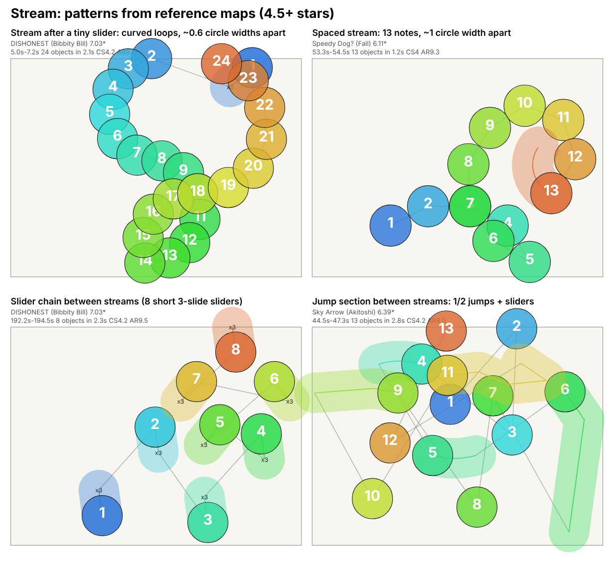

# Stream

A Stream map is built around fast, continuous runs of circles placed close together, usually on 1/4 snaps (four notes per beat; no 1/8 gaps were found in any of the 11 maps). The player keeps one rhythm going while the cursor follows a path that bends across the screen. Related patterns that belong to the same style: bursts (4-7 notes; the metric is named `burst_runs_3_7` but counts runs of 4 to 7 objects), spaced streams (the circles sit further apart, so you need aim as well as speed), deathstreams (very long streams that test stamina), curved or S-shaped streams, and the stream breaks and kick sliders that let the player recover between runs. All numbers below were measured on human reference maps of 4.5 stars and up; the data is in [data/stream.json](data/stream.json).

## What it feels like

You are tapping to the beat subdivision, not to the beat. A stream is a long fast line of notes, so most of the work is keeping the same finger rhythm while the cursor flows around a curve. In the maps I read, the circles in a stream are not in a straight line: they bend and loop (the mean turn between notes inside a stream is about 20-33 degrees (p10-p90 per band; single maps reach 40-43, for example Xenon's Extra 42.5), see "Signature patterns"), so it plays as a smooth, wide curve rather than a zig-zag.

Mappers use it for the loud, dense part of a song: fast drum fills, guitar or synth runs, a chorus climax (kiai) that should feel like a wall of notes. Streams are rarely the whole map: in the measured data a stream window (10 s) makes up about 29% of a 4.5-5.5 star map, 38% at 5.5-6.5 and 48% at 6.5+ (mean share of 10-second windows labelled S in the timeline). The rest is jumps, sliders and mixed sections.

The chorus claim was checked once with the kiai flags in the maps' timing sections (one-off script, not one of the two named tools; output in `references/_analysis/kiai_density.json`): 9 of the 11 maps have a higher object rate inside kiai than outside (ratio 0.90-3.28). Linada's Insane (0.93) and Sky Arrow (0.90) are slightly below 1. So streams do tend to sit in the loud part, but not in every map.

What makes it hard, in order of how much it matters in the examples:

1. Stamina and speed. Longest stream run in the set is 129 notes (the [Death] difficulty of Ascension to Heaven, 5.94 stars), then 113 (ABSOLUTION) and 93 (DISHONEST). At high stars the maps also have more objects per minute (see the table).
2. Spacing. The same stream is much harder when the notes are about 1 circle width apart than when they are 0.2-0.5 apart. In one mapset (Hank's Back) the same stream section is mapped at four star levels and the only big change is spacing and run length, see "Signature patterns".
3. Direction changes at the end of a stream. After a stream the cursor often has to jump 2 or more circle widths to the next head (see the picture).
4. Length without a real rest. See "Pacing and breathers".

## Measured profile

Source: [data/stream.json](data/stream.json), made with `tools/style_profiles.py` from the maps listed in "Reference set". Each cell is **p10 / p50 / p90** (the value that 10%, 50% and 90% of the maps in that star band are below). Distances are in circle widths, from where the cursor leaves one object to the next head. "Sharp turn" = a turn angle of 120 degrees or more (180 = straight back); straight-on = 30 degrees or less. Buzz and kick sliders are counts per whole map, not rates, and the maps range from about 1.2 to 7.7 minutes, so compare them loosely.

| Metric (p10 / p50 / p90) | 4.5-5.5 stars | 5.5-6.5 stars | 6.5+ stars |
|---|---|---|---|
| Maps / mapsets | 3 / 2 | 5 / 4 | 3 / 3 |
| Star range in band | 4.66-5.35 | 5.78-6.4 | 6.96-7.15 |
| Objects per minute | 263 / 264 / 264 | 275 / 302 / 318 | 335 / 345 / 345 |
| Stream % of objects | 20.6 / 28.6 / 28.6 | 30.6 / 49.1 / 50.3 | 41.2 / 56.7 / 56.7 |
| Stream run length, median (notes) | 5 / 7 / 7 | 9 / 9 / 9 | 5 / 5 / 5 |
| Stream run length, longest (notes) | 9 / 9 / 9 | 13 / 41 / 49 | 33 / 93 / 93 |
| Stream spacing (circle widths) | 0.44 / 0.54 / 0.54 | 0.27 / 0.57 / 0.86 | 0.46 / 0.62 / 0.62 |
| Jump distance, mean (circle widths) | 1.85 / 1.95 / 1.95 | 1.01 / 2.35 / 2.53 | 2.1 / 2.52 / 2.52 |
| Jump distance, 90th pct (circle widths) | 2.54 / 2.65 / 2.65 | 2.11 / 3.6 / 3.65 | 3.26 / 3.46 / 3.46 |
| Sharp-turn % | 30.3 / 36.5 / 36.5 | 7.2 / 34 / 36.1 | 15.5 / 25.6 / 25.6 |
| Sliders % of objects | 27.5 / 31.1 / 31.1 | 16.5 / 27.7 / 28.9 | 10.5 / 19.8 / 19.8 |
| Slider repeat % (sliders with a reverse) | 7.1 / 11.6 / 11.6 | 0 / 17.1 / 27.9 | 5.9 / 26.3 / 26.3 |
| Buzz sliders (count per map) | 0 / 0 / 0 | 0 / 0 / 9 | 0 / 4 / 4 |
| Kick sliders (count per map) | 3 / 6 / 6 | 0 / 8 / 9 | 3 / 5 / 5 |
| Stack % | 0.6 / 8.4 / 8.4 | 0 / 4.5 / 7.2 | 2.7 / 6.3 / 6.3 |
| Odd-rhythm % | 0.5 / 1 / 1 | 1.7 / 1.8 / 2.5 | 0 / 0.4 / 0.4 |
| Longest tapping stretch (s) | 21.7 / 24.2 / 24.2 | 9.9 / 30 / 30.2 | 35.9 / 37.5 / 37.5 |
| Longest fast-tap stretch (s) | 2 / 2 / 2 | 2 / 5 / 8 | 7 / 15 / 15 |
| Total fast-tap time per map (s) | 2 / 12 / 12 | 10 / 30 / 50 | 74 / 116 / 116 |
| Busiest 10 s (objects) | 62 / 73 / 73 | 73 / 89 / 105 | 93 / 113 / 113 |
| Straight-on turns % | 9.8 / 19.2 / 19.2 | 18 / 33.9 / 37.7 | 30.1 / 37.6 / 37.6 |
| Repeated 8-note patterns % (`rep8_pct`) | 0.4 / 2.9 / 2.9 | 0 / 13.6 / 13.8 | 10 / 27.1 / 27.1 |
| AR | 9 / 9 / 9 | 8 / 9.3 / 9.5 | 9.5 / 9.5 / 9.5 |
| OD | 7.8 / 8 / 8 | 8 / 9 / 9 | 9 / 9 / 9 |
| CS | 3 / 4 / 4 | 4 / 4 / 4.2 | 4 / 4.2 / 4.2 |

How to read this honestly:

- No row is all zero. The nearest is buzz sliders: zero in every map of the 4.5-5.5 band, and the 5.5-6.5 median is also zero. Only 4 of the 11 maps have buzz sliders at all (Death 9, Myth 15, ABSOLUTION 5, Legend 4). Note that the 5.5-6.5 p90 shows 9 because Myth's 15 is above the 90th-percentile pick.
- The bands are thin: 3, 5 and 3 maps. With 3 maps the median and the 90th percentile are the same map, so a p50 = p90 cell means "one of three maps", not "everyone agrees". The 90th percentile also hides the most extreme map: for example the 6.5+ band shows 15 s as the longest fast-tap stretch, but DISHONEST has 44 s, and the 6.5+ longest run is shown as 93 while ABSOLUTION has a 113-note run (per-map values from `metrics.json`).
- "Stream % of objects" in the 4.5-5.5 band shows 20.6 / 28.6 / 28.6, but that hides one map: with three maps the p90 is the middle one, and Xenon's Extra (5.24 stars) has 52.4%. The three maps are really 20.6% (Linada's Insane), 28.6% (smozit's Insane) and 52.4%. Linada's Insane is as low as the two excluded maps (20.1 and 15.3, see "Reference set"), so that band is a mix of stream-heavy and mixed maps and I trust it least. The same hiding happens in the 5.5-6.5 band: its p90 of 50.3 leaves out Death at 73.8%.
- The stream run length median goes down in the top band (5) because two of its three maps (ABSOLUTION and Legend) have a median run of 5 notes, many short bursts between jumps; DISHONEST's median run is 25 notes. It does not mean the top-band streams are shorter, see the longest-run row.
- Spread inside a band is large: in the 5.5-6.5 band stream spacing goes from 0.27 (Death, tightly packed notes) to 0.98 (Speedy Dog) over the five maps; the table shows 0.86 as p90.
- The time share of each 10-second window type (mean of the timeline letters, from the same JSON): S (stream) 0.29 / 0.38 / 0.48, J (jump) 0.16 / 0.30 / 0.30, L (slider-heavy) 0.10 / 0.16 / 0.09, B (bursts) 0.07 / 0.05 / 0.03, rests (.) 0 / 0.02 / 0.04 for the three bands.
- The stack % row hides the highest map too: in the 4.5-5.5 band smozit's Insane has 15.2% stacks (Xenon's Extra 0.6, Linada's Insane 8.4), and the p90 pick shows 8.4.

**Gap mix (all 11 maps, 4.5+ stars; 12,059 gaps, summed from `snaps` in `metrics.json`, saved in `references/_analysis/gap_mix.json`).** 1/4 beat 51.7%, 1/2 beat 26.0%, 1 beat 15.5%, 3/2 beat 3.3%, 3/4 beat 0.6%, 1/3 beat 0.6%, 2/3 beat 0.2%, over 2 beats 1.2%. The remaining 0.9% fit none of the usual snaps. Half of all gaps are 1/4 beat, and almost all the rest are 1/2 and 1 beat.

## Sections and breaks

From the timeline strings (one letter per 10 s) of the 11 maps: the longest stretch of one repeated letter has a median of 4 windows (40 s) and a maximum of 8 windows (80 s). Rest windows (`.`, fewer than 3 objects in 10 s) are 2.7% of all windows pooled over the 11 maps and appear in 4 of the 11 maps. Break lengths are not measured; the gaps of 4 to 8 beats described under "Signature patterns" are readings of a few maps. The kiai result is under "What it feels like".

Not measured yet: flow type (linear, angular, circular), cross-screen and 1-2 jumps, slider length and velocity, the glossary words Transition and Slider art. Deathstreams: the longest runs in the set are 129, 113 and 93 notes (see "What it feels like").

## Signature patterns

What I saw by reading excerpts of the raw maps and the timeline strings. Statements marked "in the examples I read" are my reading of a handful of maps, not a measured statistic. The picture shows four of them: 

How to read the picture: numbers are play order, blue is first and orange is last; grey lines are the cursor path; a translucent band is a slider; x3 means three slides (two reverses). Each panel is a 1-4 second excerpt of one reference map. Known drawing flaw: in the top-left panel the AR label in the subtitle is partly covered by circles; the picture would need a re-render with clipping.

**1. A stream is usually a smooth curve, and its spacing is constant inside a short run.** In DISHONEST (7.03 stars) most 29-note runs sit at 0.62-0.63 circle widths per note; some are wider (per-run means of 0.69-1.08 in the last stream block). The path bends in loops and S-curves rather than lines (top left of the picture). Inside one long run the spacing goes up in steps as the song builds: in the final stream of DISHONEST I read steps of about 0.63, then 0.78, then 0.93, then 1.27 circle widths, each held for 12-16 notes (the 29-note run starting at 267.5 s has a mean of 1.08 because it contains both the 0.93 and the 1.27 step). The measured mean turn inside streams (`stream_turn_mean_deg` in the data) is 24.2 degrees (p50, 4.5-5.5), 24.6 (5.5-6.5) and 29.9 (6.5+), which backs up "gentle curves".

**2. Run lengths are mostly 4n+1 notes (5, 9, 13, 17, 21, 25, 29...).** In the examples I read (Hank's Back, DISHONEST, Legend, Myth) streams start on a beat and end on one, so a run is a whole number of beats of 1/4 notes plus the starting note; a short slider or a single circle often finishes it. The 5-note burst is exactly one beat.

**3. How streams start and end.** In the examples I read, the common start is a short slider whose head is 1 beat before the first stream note, then a hop of about 1.5 to 5 circle widths to that first note (DISHONEST 1.3-3.3 after a 1-beat gap (one hop of 5.6 at 270 s), 3.5-4.3 after a half-beat gap before the long runs, up to 4.7 before 5-note bursts; Speedy Dog 1.5-5.6 in the Hank's Back section, with two hops near 0). The common ending is one small slider (a plain slider of 0.25-0.5 beat, or a 3-slide slider of 0.75 beat) that lands where the next group begins. In DISHONEST nearly every long run is bracketed this way: a 3-slide short slider, 1 beat, a run of 13 to 29 notes ending in another 3-slide slider. In Death (5.94 stars) and Myth (6.4 stars) a run is often followed or preceded by a wait of 4 to 8 beats (about 1.2-2.4 s at a 300 ms beat; at those spots the beat is 300 ms, Death is 190-200 BPM and Myth 170-200 BPM overall), for example Death at 102 s (4 beats, then a 6.6 circle-width hop into a 65-note run) and Myth at 299.8 s (8 beats before a 29-note run).

**4. Sliders between streams are small and they chain.**
- 3-slide short sliders (two reverse arrows, about 0.75 beat long, about 45 px of track): DISHONEST uses them one per beat in a chain of 8 (192-194.5 s, bottom left of the picture); Death chains 2 to 4 of them (21.0 s and 28.8 s) and Myth does the same around 303 s. The cursor barely moves while the player holds each one. They are not counted as buzz or kick sliders by the analyzer (buzz needs 4+ slides, kick is exactly 2).
- Single short sliders (one slide, 0.25-0.5 beat) are the most common way a run ends in the examples I read (Speedy Dog, Death, Legend, Sky Arrow).
- Buzz sliders (very short, many repeats): ABSOLUTION at 97.9 s and Myth at 304 s put a 7-slide buzz slider (6 reverses) at the end of a short stream, then the next group follows 1-2 beats later. Death has 9 buzz sliders and Myth 15; elsewhere they are rare (see table).
- Kick sliders (short, exactly one reverse): the table shows a median of 5 to 8 per map. One passage I read is Myth at about 244-250 s, where kick sliders alternate with single and 3-slide sliders every 0.75 beat, with a 9-note run between each group (about every 2.8 s).
- Long sliders appear as real pauses: DISHONEST has a 7.75-beat slider (about 2.5 s) at 197 s, right after a 33-note run, and Death has a 2-beat slider (362 px long) after a burst at 27.6 s.

**5. Stacks are used as speed-up and as pacing.** Stacks (circles at the same position, distance below 0.05 circle widths) are 0 to 15.2% of notes across the 11 maps (0 to 11% in the 5.5-6.5 band, p10-p90 0-7.2). In the examples I read they appear in three ways: a 3-note stack at 1/4 snaps in the middle of 1/2 jumps (DISHONEST at 45 s and 84-85 s); two circles and a slider on one spot (Sky Arrow at 64-71 s, repeated about every 0.65 s, each one after a cross-screen 1/2 jump of about 2.5 circle widths); and one long stack used as a rhythm pad (Death at 32.4 s: 9 notes on one spot at 1/4, then sliders).

**6. Burst-and-jump sections between streams.** In the examples I read, the bridge between stream parts is made of 1/2-beat jumps of 2 to 4.5 circle widths (cross-screen), often with a 4-5 note burst at 0.47-0.48 spacing at the end of the phrase. Examples: DISHONEST at 23-27 s (two 1/2 jumps of about 3 circle widths, then a 5-note burst at 0.47 spacing, then the next jumps of 3 to 4.5 circle widths), Sky Arrow at 44-52 s (most steps are 2.5-3.9 circle widths, up to 4.9, with a burst of 2-3 notes at the end of a phrase, bottom right of the picture), Legend at 119-125 s. Jump direction in these sections swings back and forth across the screen (the criss-crossing lines in the bottom-right panel). That is my reading and fits the sharp-turn medians of 36.5, 34 and 25.6% across the three bands. Inside the streams the direction changes are small (item 1). My interpretation, not measured: the sharp-turn % falls with stars because the share of smooth stream grows.

**7. Same section, four difficulties (Hank's Back, 4.66 to 6.11 stars).** The section from about 53 s to 76 s is the same rhythm in four difficulties: a short slider, one beat, a run, repeat. What changes is spacing and run length: smozit's Insane (4.66 stars) uses 5-note bursts at about 0.55 circle widths, Xenon's Extra (5.24) uses 13/9-note runs at about 0.70-0.85, Daycore's Expert (5.78) 9-13 note runs at about 0.86-0.90, and Speedy Dog (6.11) 9-13 note runs at about 1.0-1.15 circle widths (a spaced stream, top right of the picture). That is the cleanest evidence in the set for how a mapper scales a stream up: same rhythm, wider spacing and longer runs, not more notes.

**8. Tight streams exist too.** Death (5.94 stars) plays about 0.18-0.2 circle widths per note in several long runs (and 0.37-0.47 in the 129-note one), so the circles overlap almost fully. In the examples I read Death is tight (under 0.3) in about half of its runs (15 of 31) and Myth in about a third (29 of 87). Myth also has tight runs: several at 0.26-0.28 and four at 0.11-0.13 (and one at 0.05) circle widths per note, mixed with runs at 0.5-0.55, which is why its map mean is 0.41. The band's p10 of 0.27 for stream spacing is Death's map mean.

**9. Maps are not all stream.** Sky Arrow (6.39 stars) is stream % 30.6, and its timeline is `LJJSJJJJLSSSSJJBJS`: mostly jump windows with a few stream windows. Legend (7.15 stars) is `mLLLJBJJJJJBSSSSJJJJJJSSSSmLJJJSJLJSSJSSSJSJSS`. DISHONEST is `SSSJJJJJSSSJJLJSSJSSLSSSSSSSS.` Death is `mLSSSSmmmBSSSSm.` (S almost everywhere in the loud sections). One letter is 10 seconds.

## Pacing and breathers

Your pacing rule is that a player should not spam-tap for longer than about 10-15 seconds, and sliders or buzz sliders should give a break to catch up (as in Honesty). The only Honesty map in the data is DISHONEST (mapset HONESTY), which has a 68.1 s tapping stretch with no rest and a 44 s fast-tap stretch; its relief is the 3-slide sliders and 1-beat gaps described below. I cannot tell from the numbers whether those are the "Honesty" relief you meant, so please say if you meant something else. Here is what the data says, with the measurement definitions first:

- Longest tapping stretch = seconds between rests, where a rest is a gap of at least 1.45 beats or a slider held at least 0.97 beat. A 1-beat gap after a short slider does not count as a rest.
- Longest fast-tap stretch = consecutive 1-second bins with at least 8 key presses (real stream-speed tapping).

What the human maps do:

- By the strict "tapping stretch" measure, 10 of the 11 maps have at least one stretch longer than 15 seconds. The longest stretch per map goes from 9.9 s (Sky Arrow, the only map under 10 s) to 68.1 s (DISHONEST); medians per band are 24.2 s, 30 s and 37.5 s. So the human maps do break your rule if the rule counts any note. The cause is that their breathers are mostly short: one beat of gap, a 3-slide slider, a kick slider.
- By the fast-tap measure, the maps keep close to your rule: 9 of 11 maps never have a stream-speed stretch over 10 s. Only two maps go above 10 s: ABSOLUTION (15 s) and DISHONEST (44 s). The other nine stay at 10 s or less; 8 of the 11 are at 8 s or less (Death is the 10 s one). The 6.5+ band is the one that tests stamina: median longest fast-tap stretch 15 s, total fast-tap time 74 / 116 / 116 s per map.
- Where they break it hardest: the last part of DISHONEST (about 218-290 s). Its timeline ends `...LSSSSSSSS.`: runs of mostly 21 to 33 notes plus 85- and 93-note runs (and a few 5-17 note bursts at the start) are separated only by a 3-slide slider and a 1-beat gap (about 0.3 s, with a few 2-beat gaps), for about 70 seconds. That matches its 68.1 s tapping stretch and 44 s fast-tap stretch (the 44 s stretch starts at about 247 s; DISHONEST also has 21 s (from 3 s), 13 s (from 96 s) and 12 s (from 226 s) stretches, so it breaks the 10 s limit four times). It reads as a deliberate stamina finale, not typical pacing for the set.

What they do instead of resting (in the examples I read):

1. A short slider at the end of each run (kick or 3-slide). The player holds one key for about 0.25-0.75 beat and the cursor barely moves.
2. A 1-beat or longer gap before the next run, long enough to reposition.
3. A bigger gap (4 to 8 beats, about 1.0-2.4 s depending on BPM) between big stream blocks, especially in Death, Myth and Legend.
4. Switching to jump windows: 10 of the 11 maps have J windows in their timeline (Death is the exception). The mean share of J windows is 16, 30 and 30% in the three bands.
5. Long sliders, buzz sliders and spinners (a 7.75-beat slider in DISHONEST; spinners in 6 of the 11 maps).

The shorter the break, the more it relies on a slider to hold the hand still, which fits your "sliders bring the player back to life" idea. For a generator, a rule that fits both your pacing idea and the data: keep the fast-tap stretch at 10 s or less except for at most one deliberate finale (that part is measured: 9 of 11 maps never exceed 10 s; the one-finale target is stricter than DISHONEST itself, which has four such stretches, while ABSOLUTION has one of 15 s), and put a slider or a gap of 1 beat or more between runs (observed in every map I read). The "every 10-15 seconds" interval itself is your rule, not something the human maps follow by the tool's tapping-stretch measure.

## Targets for the generator

Measurable targets for a Stream-style map, taken straight from the p10-p90 ranges above. The ranges for 4.5-5.5 and 6.5+ come from only 3 maps each, so where p10 and p90 are almost the same number treat it as a centre point, not a limit.

- 4.5-5.5 stars
  - Objects per minute about 263-264 (3 maps; the 5.5-6.5 range starts at 275).
  - Stream % 20.6-28.6 (Xenon's Extra, one of the 3 maps, is at 52.4, so treat the top as open); longest run 9 notes in the table (Xenon's Extra reaches 13); stream spacing 0.44-0.54 circle widths.
  - Jump distance mean 1.85-1.95, p90 2.54-2.65 circle widths; sharp turns 30-37%.
  - Sliders 27.5-31%; slider repeat 7-12%; no buzz sliders; 3-6 kick sliders per map; stacks 0.6-8.4% (smozit's Insane reaches 15.2%; 3 maps only).
  - Longest fast-tap stretch about 2 s. (The human longest tapping stretch is 21.7-24.2 s, but that is not a target, see "All bands".)
- 5.5-6.5 stars
  - Objects per minute 275-318; stream % 30.6-50.3.
  - Longest run 13-49 notes (one of the five maps has a 129-note run, so 49 is not a ceiling); median run about 9; stream spacing 0.27-0.86 (p10-p90; the full spread of the five maps is 0.27-0.98).
  - Jump distance mean 1.01-2.53, p90 2.11-3.65; sharp turns 7.2-36.1%.
  - Sliders 16.5-28.9%; slider repeat 0-27.9%; buzz sliders 0-9; kick sliders 0-9; stacks 0-7.2%.
  - Odd rhythm 1.7-2.5%; longest fast-tap stretch 2-8 s. (Human longest tapping stretch 9.9-30.2 s: not a target.)
- 6.5+ stars
  - Objects per minute 335-345; stream % 41.2-56.7.
  - Longest run 33-93 notes (ABSOLUTION has a 113-note run, so 93 is not a ceiling); stream spacing 0.46-0.62.
  - Jump distance mean 2.1-2.52, p90 3.26-3.46; sharp turns 15.5-25.6%.
  - Sliders 10.5-19.8%; slider repeat 5.9-26.3%; buzz 0-4; kick sliders 3-5; stacks 2.7-6.3%; odd rhythm up to 0.4%.
  - Longest fast-tap stretch 7-15 s (one map of 3 reaches 44 s; do not copy that). (Human longest tapping stretch 35.9-37.5 s: not a target.)
- All bands: end runs on a beat, put a short slider or a 1-beat gap between runs, avoid fast-tap stretches over 10 s except in one climax section. Longest tapping stretch: keep at 10 s or less (preset `max_tap_s`); do not use the human tapping-stretch ranges above as targets.

Check a generated map against these numbers:

```
python tools/analyze_maps.py <file.osu>
```

## Reference set

Used (4.5 stars and above, standard mode, labelled "stream" by the user, minus the excluded maps): 11 difficulties from 7 mapsets. Titles, artists, mappers and star ratings only; the files stay local (references/ is git-ignored).

| Song (artist) | Mapper | Difficulties used (stars) | Band |
|---|---|---|---|
| Hank's Back (Lil Hank) | Fall | smozit's Insane (4.66), Xenon's Extra (5.24), Daycore's Expert (5.78), Speedy Dog (6.11) | 4.5-5.5 and 5.5-6.5 |
| Asu no Yozora Shoukaihan (Yuaru) | Akitoshi | Linada's Insane (5.35), Sky Arrow (6.39) | 4.5-5.5 and 5.5-6.5 |
| Ascension to Heaven (xi) | Shiirn | Death (5.94) | 5.5-6.5 |
| Through the Fire and Flames (DragonForce) | Ponoyoshi | Myth (6.4) | 5.5-6.5 |
| Ange du Blanc Pur (ke-ji feat. Nanahira) | BarkingMadDog | ABSOLUTION (6.96) | 6.5+ |
| HONESTY (GYZE) | Bibbity Bill | DISHONEST (7.03) | 6.5+ |
| Operation Ground and Pound (DragonForce) | Atsuro | Legend (7.15) | 6.5+ |

Not used, and why:

- Excluded as mislabeled by the audit: the Yuaru mapset's [Insane] (4.96 stars; stream 20.1% of objects, longest run 7 notes, sliders 49.1%) and [dqs01733's Extra] (5.62 stars; stream 15.3%, longest run 9 notes). They are slider-and-jump maps, not stream maps. The Linada's Insane map kept in the data (stream 20.6%, longest run 9) is as weak as those two, so the 4.5-5.5 band deserves suspicion; I kept it because the audit did not flag it.
- Below 4.5 stars: Easy (1.86), Normal (2.43) and Hard (3.54) of the Yuaru mapset, and Light Insane (4.1), Normal (2.27) and Hard (3.58) of Hank's Back. The user labels whole mapsets, and these are not representative of the style.
- The Ascension to Heaven mapset also contains a taiko difficulty (Mode 1), which the analyzer skips.

Sample sizes and weaknesses: 11 maps in 7 mapsets, 3 bands of 3, 5 and 3 maps. Each band has 2 to 4 mapsets, so one mapper (Fall: 4 of 11 maps, Akitoshi: 2) pulls the band. The set mixes song lengths from 1.2 to 7.7 minutes (the Hank's Back maps are about 1.2 minutes), so per-map counts are not comparable. p10-p90 on 3 maps is a range from 1-3 maps, not a distribution. Treat all of this as a first calibration to be rechecked when more stream maps are added.

## See also

- [Style documentation: start here](Instruction.md)
- [Jump](jump.md)
- [Tech](tech.md)
- [Balanced](balanced.md)
