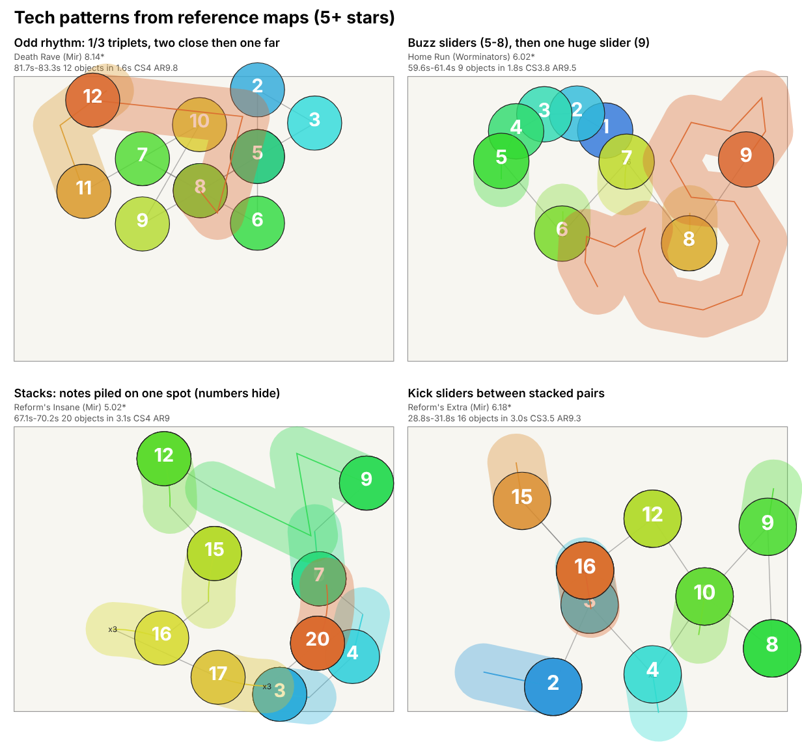

# Tech

A Tech map gets its difficulty from reading, not from raw speed or long jumps. The rhythm keeps changing (quarter-beat bursts, half-beat pairs, three-quarter-beat gaps, and in a few maps 1/3 and 1/6 triplets), about half of all objects are sliders, nearly all of them shorter than one beat, and the mapper keeps mixing in stacks, kick sliders and buzz sliders. The hops between notes are short (mean 1.3 to 2.5 circle widths per map; band p10-p90: 1.3 to 2.4), and in the examples I read they do not keep one direction or one spacing for long. Streams exist, but mostly as short bursts that start right after a slider and usually end on one, not as long walls of notes.

This page is based on 21 human-made osu!standard difficulties of 4.5 stars and above (7 mapsets), measured with `tools/analyze_maps.py` and summarised with `tools/style_profiles.py`. The numbers are in [data/tech.json](data/tech.json). The generator style it documents is "Technical" (params key `tech`).

## What it feels like

You are rarely doing the same thing for more than a second or two. The most common burst I counted is four circles on quarter-beat spacing followed by a slider (183 of the 494 bursts and streams in the 21 maps; 161 of them also have a slider right before the burst; counts from a one-off script); the rest of a phrase is a mix of half-beat circles, stacks, kick sliders and short sliders. The sliders are short (median 98% of sliders are under one beat per slide in all three bands; the median slide is 0.25 beat at 5.5 stars and above and 0.5 beat at 4.5-5.5), so you almost never sit on a long slider. On average you hit 4 to 4.6 objects per second (median 240 to 277 objects per minute), and about half of them are sliders.

Playing it is about recognising each little shape in time. In the examples I read, the same rhythm almost never repeats twice in a row (the share of repeated 8-note windows is 0.0 to 5.5%, p10 to p90, in the two bands that have enough maps), so you cannot settle into a pattern the way you can in a stream map.

What makes it hard, in the order I would rank it (my reading of the numbers and the excerpts):

- **Rhythm and slider reading.** Half of the objects are sliders (median 56%, 50% and 43% at 4.5-5.5, 5.5-6.5 and 6.5+ stars), with a median of 14.5%, 4.9% and 7.0% of them repeating (kick sliders and buzz sliders). Across the 21 maps there are 421 kick sliders and 128 buzz sliders, and 20 of the 21 maps contain kick sliders, 17 contain buzz sliders.
- **Spacing that keeps changing.** The spread of jump distance (coefficient of variation, the tool's `jump_cv`) has a median of 0.62, 0.44 and 0.52 in the three bands. The Jump page reports 0.34 for jump maps, so tech spacing is less constant. Stacks (0 distance) sit next to hops of 2 to 5 circle widths in the same phrase.
- **Direction that is not predictable.** Turns are spread out: the sharp-turn share (120 degrees or more) is only 25 to 42% and the straight-on share (30 degrees or less) is 11 to 25% (medians 33/38/40% sharp and 25/23/20% straight). That is a mix of flow and snaps, not the 78 to 83% sharp turns reported for Jump maps.
- **Speed is the smaller part.** Objects per minute are 240, 277 and 271 (medians), AR is 9.0 to 9.7 (median), and the longest fast-tap stretch (8 or more key presses per second) is 1, 4 and 3 seconds (medians).

Tech spans two flavours in this reference set, and the data shows both: stream-leaning tech (PRIIDS' Gonna Miss You has 36.0% of objects in streams and 21.6% sliders; Hemophilia has 31.5% streams) and slider-leaning tech (Nagabi's Heart Taken By Lolicops has 72.5% sliders and 3.8% streams; Minorsonek's Extreme has 69.6% sliders and 3.8% streams). Both kinds carry your tech label (labels are by mapset, so I do not know the reason); what they share in the data is a high share of odd rhythm, kick sliders, stacks and short sliders.

I did not use audio, so I cannot say which parts of each song these patterns line up with by ear. One check I could do is the kiai flags in the timing sections (one-off script, saved in `references/_analysis/kiai_density.json`): 19 of the 21 maps have kiai flags, and in all 19 the object rate is higher inside kiai than outside (ratio 1.05-2.51). The other 2 maps (Drop's Another and Let's Do This!) have no kiai flags. Break and quiet-part placement is not measured.

## Measured profile

All cells are p10 - p50 - p90 over the maps in that band (from `data/tech.json`). Distances are in circle widths. The 4.5-5.5 band has only 3 maps from 3 mapsets, so its three percentiles are almost always the same one or two maps: read it as three examples, not as a range. The 5.5-6.5 and 6.5+ bands have 9 maps each (6 and 4 mapsets), which is still thin.

| Metric | 4.5-5.5 stars (weak, n=3) | 5.5-6.5 stars | 6.5+ stars (stars up to 8.14) |
|---|---|---|---|
| Maps / mapsets | 3 / 3 | 9 / 6 | 9 / 4 |
| Objects per minute | 219-240-240 | 233-277-291 | 228-271-344 |
| Busiest 10 s (objects) | 57-57-57 | 56-67-81 | 59-70-81 |
| Stream, % of objects | 5-11-11 | 3.8-18.3-26.3 | 3.8-16.5-31.5 |
| Run length, median (objects) | 5-5-5 | 5-5-5 | 5-8-9 |
| Run length, longest in map | 9-9-9 | 9-21-33 | 5-17-49 |
| Stream spacing | 0.25-0.26-0.26 | 0.32-0.56-0.62 | 0.39-0.62-0.72 |
| Jump distance, mean | 1.31-1.58-1.58 | 1.72-2.01-2.12 | 1.58-2.1-2.4 |
| Jump distance, p90 | 2.51-2.94-2.94 | 2.67-3.16-3.37 | 3.04-3.5-3.69 |
| Sharp turns (120 deg or more), % of turns | 25-33.1-33.1 | 28.4-37.8-40.2 | 33.2-39.5-41.9 |
| Straight-on turns (30 deg or less), % | 19.4-24.7-24.7 | 10.6-22.7-24.9 | 13.5-19.9-24.4 |
| Sliders, % of objects | 51.6-56.2-56.2 | 41.3-50-62.6 | 21.6-42.5-68 |
| Sliders with a repeat, % of sliders | 11.7-14.5-14.5 | 3.9-4.9-7.1 | 1.6-7-14.6 |
| Buzz sliders per map | 3-4-4 | 0-2-17 | 0-4-7 |
| Kick sliders per map | 13-42-42 | 0-16-33 | 2-12-36 |
| Stacks, % of objects | 7.5-7.8-7.8 | 1.3-7.2-15.7 | 0-6.9-14.5 |
| Odd rhythm (1/3, 1/6, 2/3, 3/4), % of gaps | 5.2-11.1-11.1 | 1.6-9.8-11.1 | 2.2-7.9-10.6 |
| Longest tapping stretch (s) | 12.6-36.2-36.2 | 17.6-52.7-58.4 | 10.3-22-45 |
| Longest fast-tap stretch (s) | 1-1-1 | 1-4-7 | 0-3-5 |
| Total fast-tap time per map (s) | 5-10-10 | 1-24-59 | 0-23-51 |
| Repeated 8-note patterns % (`rep8_pct`) | 0-0-0 | 0-0.5-5.5 | 0-0.2-4.9 |
| AR | 9-9-9 | 9-9.4-9.6 | 9-9.7-10 |
| OD | 8-8-8 | 8-8.4-8.7 | 8-8.5-9 |
| CS | 3.8-4-4 | 3.5-4-4.1 | 3.8-4-4.1 |

Zeros do appear at the low end: p10 of buzz sliders is 0 in the two upper bands, p10 of stack % is 0 in the 6.5+ band, and the longest fast-tap stretch is 0 s at p10 in that band. Timeline shares (mean of 10 s windows, from `timeline_share_mean`): slider-heavy windows are 66%, 55% and 47% of windows, stream windows 5%, 15% and 17%, burst windows 14%, 16% and 8%, jump windows 3%, 4% and 11%, mixed 12%, 9% and 13%, rests 1%, 3% and 4%. In words: most of a tech map is slider-heavy ground with bursts and streams dropped in.

Two notes on how to read the odd-rhythm row. It counts gaps of 1/3, 1/6, 2/3 and 3/4 beat together, and in these 21 maps it is mostly the 3/4-beat gap (a dotted eighth). Summed over all 21,853 gaps in the 21 maps (from `snaps` in `metrics.json`): 1/4-beat gaps are 31.0%, 1/2-beat 37.9%, 1-beat 17.5%, 3/4-beat 6.6%, 3/2-beat 1.5%, 1/3-beat 1.2%, 2/3-beat 0.3%, 1/6-beat 0.3%, and 1/8-beat 0.0% (2 gaps). That adds up to 96.3%; the rest are gaps over 2 beats and some gaps that fall outside the listed snaps. Real triplets are concentrated: 1/3-beat gaps appear in only 6 of the 21 maps (Death Rave 89, Reform's Extra (KillerBeast) 60, thzz's Blaster 57, Insane (KillerBeast) 47, Seeing Stars 12, Lasse's Extra 6), 4 of them from the KillerBeast set, and 1/6-beat gaps in 2 (Death Rave 48, thzz's Blaster 18). So "odd rhythm" in the generator should mostly mean 3/4-beat gaps and syncopation, and only occasionally real triplets.

Slider shapes summed over the 21 maps: about 42% perfect-circle arcs, 36% straight, 22% bezier (4671 / 3977 / 2415 sliders). Every map uses at least 5 slider velocities besides the base one, and BPM ranges from 153 to 280 across the set.

## Signature patterns



The picture shows four excerpts of 1.6 to 3.1 seconds from reference maps (numbers are play order, blue first, orange last; a stack shows as one circle with the other numbers hidden under it). What follows is what I saw in the raw maps and the timeline strings. Statements that count things (runs, sliders) come from the tool's parser; statements marked "in the examples I read" are my reading of a few maps, not statistics.

**Streams are short bursts that end on a slider.** I counted 494 runs of 4 or more objects at 1/4 beat or faster across the 21 maps. Median length is 5 objects and 233 of them (47%) are exactly 5. Of those 233 runs, 183 are four circles followed by a slider ("circle, circle, circle, circle, slider"). Overall, 480 of 494 runs start with a circle, 409 are preceded by a slider, and about 80% end on a slider (394 of the 492 runs that have an object after them). These shape counts come from a one-off script; only the 494 runs and their lengths are in `metrics.json`. Spacing in these 5-object bursts is a median 0.44 circle widths, so they are tight but not stacked. Only 49 runs (10%) have 16 or more objects, and 12 have 25 or more: for example Hemophilia (57 objects at 31.3 s), Hemophobia (49), Death Rave (33, twice), Home Run (Cycle Hit, 33) and Extra (Hype, thiev, 33). The 12 runs of 25 or more objects are all in maps of 6.0 stars and above.

**What sits between streams.** In the examples I read the space is filled with short sliders, not rest. In Final Farewell (124 to 131 s) a quarter-beat slider arrives every half beat for about 7 seconds, with the cursor usually travelling 2 to 4.6 circle widths between them (a few are stacked), and the same opening motif (a circle, then two sliders of 103 px, then longer ones) returns about 5.5 seconds later. In Death Rave (183 to 187 s) a run of quarter-beat sliders every half beat gets longer in steps (38, 50, 75, 100, 125 px) while the hop to the next one grows from about 1 to about 2.5 circle widths; the sequence then restarts at 185.2 s and ends in ten circles on 1/3-beat spacing. In Hemophilia (141.5 to 142.1 s) four quarter-beat circles and a stacked slider run into three quarter-beat sliders at growing spacing (2.0, 3.1 and 4.5 circle widths).

**Buzz sliders come in rows, usually after a burst.** Short sliders with 4 to 6 repeats appear in rows of 4. In Home Run (59.6 to 61.4 s, top-right panel) a stream of about a dozen circles about 0.6 circle widths apart is followed by four buzz sliders of 6 slides each, one per beat and about 1.7 to 1.9 circle widths apart, and then one slider 15 beats long. In Reform's Extra (84.8 to 85.9 s) four 5-slide buzz sliders also come one per beat, about 1.0 to 1.4 circle widths apart. 17 of 21 maps have at least one buzz slider, but the median is only 4, 2 and 4 per map by band; Home Run has 27 and Reform's Extra 17, the two highest counts.

**Kick sliders are the glue.** 20 of 21 maps have at least one; the median per map is 42, 16 and 12 by band and the highest is 65 (Drop's Another). In Reform's Extra (28.8 to 31.8 s, bottom-right panel) a pair of kick sliders about 1.6 circle widths apart and one beat apart is followed by two stacked circle pairs on half-beat spacing, then two more kick sliders, and the cycle repeats. In Insane (54.7 to 57 s) a chain of kick sliders about 0.27 s apart makes hops of about 1.4 circle widths.

**Stacks come as pairs and triples, then a small hop.** 7 of 21 maps have stacks as 10% or more of their objects (the highest are Reform's Insane at 24.9%, PRIIDS' Gonna Miss You 24.9%, and Lasse's Extra 18.6%). In Reform's Insane (Hype lapix Remix, 67 to 70 s, bottom-left panel) the pattern is circle, circle, slider on one spot at quarter-beat spacing, then a hop of 1.0 to 1.4 circle widths and the next stack. In Reform's Extra (35.1 to 36.0 s) it is a run of stacked pairs on half-beat spacing that alternate between two spots 2.5 to 2.7 circle widths apart, which reads like a 1-2 jump.

**Odd rhythm: triplets in a repeating group, and 1/6 bursts.** In Death Rave (81.7 to 83.3 s, top-left panel) ten circles on 1/3-beat spacing repeat a group of three: two short steps of 1.2 circle widths and one longer step of about 2.1 to 2.5, three times, then a half-beat slider and a 1.5-beat slider with one reverse. The same map opens a section (78.8 to 80.3 s) with a 1/6-beat run of 24 circles only 0.1 to 0.5 circle widths apart. The more common odd gap overall is the 3/4 beat (6.6% of gaps), which gives a dotted feel without any triplet; I did not read examples of it, so I cannot describe its shapes.

**Jump direction.** Hops are short (mean 1.3 to 2.5 circle widths per map; band p10-p90: 1.3 to 2.4) and the turn angle mean is 80 to 93 degrees by band median (76 to 103 across single maps), so the cursor neither zig-zags nor runs straight. The p90 jump distance is 2.5 to 3.7 (band p10-p90; single maps reach 4.7) circle widths, and the occasional long snap (4 to 5.4 circle widths in Death Rave and Final Farewell) shows up between short sliders. Which of the two directions (linear flow, angular, circular) a mapper uses is not measured separately here.

## Pacing and breathers

The 10-15 second rule is about spam-tapping. Measured as fast tapping (8 or more key presses in a second), Tech maps follow it: the longest fast-tap stretch in any of the 21 maps is 8 seconds (Death Rave), none has one over 10 seconds, and 7 of 21 maps reach 5 seconds or more. By band, the p90 is 1 s (4.5-5.5, n=3), 7 s (5.5-6.5) and 5 s (6.5+). Total fast-tapping time per map is a median 10 s, 24 s and 23 s.

Measured as time without a rest, the human maps do break the rule, and the tool's definition matters. A rest there is a gap of 1.45 beats or more, or a slider held for 0.97 beat or more. Tech maps are built from short sliders and half-beat gaps, so there are often no such rests for a long time:

- Longest tapping stretch, p10 - p50 - p90: 12.6 - 36.2 - 36.2 s (4.5-5.5, n=3), 17.6 - 52.7 - 58.4 s (5.5-6.5), 10.3 - 22 - 45 s (6.5+).
- Per map: 19 of 21 maps have a stretch over 15 s, 12 over 30 s and 2 over 60 s (Seeing Stars 75.4 s, Final Farewell 90.3 s). Only Insane (12.6 s) and Hemophobia (10.3 s) stay under 15 s. These stretches are mostly half-beat slider and jump phrases, not stream speed, but they are still a long time without a gap of 1.5 beats.

What the maps do instead:

- **Long sliders as breathers.** Counting sliders held for 0.97 beat or more with a short script on the tool's parser (one-off script), the median map has 33 of them (range 16 to 87) and about 12 rest gaps of 1.45 beats or more, together about 12 seconds of rest per minute of map. Home Run follows its stream and four buzz sliders with a 15-beat slider (about 5 seconds at its 175 BPM). Insane and Death Rave (KillerBeast) each have a slider of about 23 beats.
- **Breaks.** Windows of 10 s with fewer than 3 objects are 1%, 3% and 4% of windows. The longest gap I found is 80 beats (Hemophobia), and 16 of the 21 maps have a gap of 20 to 40 beats somewhere (17 counting Extra at 19.9995 beats; one-off script) (probably the intro or a mid-song break; I did not check which).
- **Slider chains instead of streams.** The slider-heavy sections (47 to 66% of windows) are where the player is still moving at about 4 to 4.6 objects per second on average (median 240 to 277 per minute) but is not spam-tapping fast.
- **Short bursts.** Runs of 4 to 9 objects are 413 of the 494 runs (84%; median run 5), so fast tapping mostly arrives in pieces of about a second.

The practical reading for the generator: in this reference set fast-tapping stays at 8 s or less, and the stretches of any kind of tapping without a real rest are long. To follow the user's pacing rule, the generator should be stricter than the human p90 on tapping stretches (see the targets) and use sliders of one beat or longer, or gaps of 1.5 beats or more, as the breather, the way the human maps do. Rule: a slider held 0.97 beat or longer, or a gap of 1.45 beats or more, at least every 11 s (preset `max_tap_s`); fast-tap stretches 8 s or less (the human maximum).

## Sections and breaks

From the timeline strings (one letter per 10 s) of the 21 maps: the longest stretch of one repeated letter has a median of 6 windows (60 s) and a maximum of 15 windows (150 s), which fits the slider-heavy ground described above. Rest windows are 2.5% of all windows pooled over the 21 maps and appear in 9 of the 21 maps. The kiai result is under "What it feels like". Break lengths are not measured beyond the long gaps counted under "Pacing and breathers".

Not measured yet: flow type (linear, angular, circular), cross-screen and 1-2 jumps (the stack-pair excerpt that "reads like a 1-2 jump" is my reading), slider length and velocity (SV; only the number of distinct velocities is noted above), and the glossary words Transition and Slider art.

## Targets for the generator

Ranges are the p10 to p90 of the human maps in the band. A generated Tech map should fall inside them, except where noted. Where the human range for tapping stretches is wider than the 10-15 second rule, keep the generator inside the rule.

**4.5-5.5 stars (3 maps, 3 mapsets: weak evidence, only a rough guide)**

- Objects per minute 219 to 240; busiest 10 s about 57 objects.
- Stream 5 to 11% of objects; longest run 9 objects; stream spacing 0.25 to 0.26 circle widths.
- Mean jump distance 1.3 to 1.6 circle widths; p90 jump 2.5 to 2.9.
- Sharp turns 25 to 33% of turns; straight-on 19 to 25%.
- Sliders 52 to 56% of objects; sliders with a repeat 12 to 15%; buzz sliders 3 to 4; kick sliders 13 to 42.
- Stacks 7.5 to 7.8%; odd rhythm 5.2 to 11.1% of gaps.
- Longest fast-tap stretch 1 s. Longest tapping stretch: keep at 15 s or less (the three human maps measure 12.6 to 36.2 s).
- AR 9, CS 3.8 to 4.0.

**5.5-6.5 stars (9 maps, 6 mapsets)**

- Objects per minute 233 to 291; busiest 10 s 56 to 81 objects.
- Stream 3.8 to 26.3% of objects; median run 5; longest run 9 to 33; stream spacing 0.32 to 0.62 circle widths.
- Mean jump distance 1.7 to 2.1 circle widths; p90 jump 2.7 to 3.4.
- Sharp turns 28 to 40% of turns; straight-on 11 to 25%.
- Sliders 41 to 63% of objects; sliders with a repeat 3.9 to 7.1%; buzz sliders 0 to 17; kick sliders 0 to 33.
- Stacks 1.3 to 15.7%; odd rhythm 1.6 to 11.1% of gaps.
- Longest fast-tap stretch 1 to 7 s. Longest tapping stretch: keep at 15 s or less (human p10 to p90 is 17.6 to 58.4 s, so even the human low end breaks the rule).
- AR 9.0 to 9.6, CS 3.5 to 4.1.

**6.5+ stars (9 maps, 4 mapsets; stars 6.5 to 8.14)**

- Objects per minute 228 to 344; busiest 10 s 59 to 81 objects.
- Stream 3.8 to 31.5% of objects; median run 5 to 9; longest run 5 to 49; stream spacing 0.39 to 0.72 circle widths.
- Mean jump distance 1.6 to 2.4 circle widths; p90 jump 3.0 to 3.7.
- Sharp turns 33 to 42% of turns; straight-on 13.5 to 24.4%.
- Sliders 22 to 68% of objects; sliders with a repeat 1.6 to 14.6%; buzz sliders 0 to 7; kick sliders 2 to 36.
- Stacks 0 to 14.5%; odd rhythm 2.2 to 10.6% of gaps.
- Longest fast-tap stretch 0 to 5 s. Longest tapping stretch: keep at 15 s or less (human p10 to p90 is 10.3 to 45 s).
- AR 9.0 to 10.0, CS 3.8 to 4.1.

Across all bands: nearly all sliders (94% or more at p10) should be shorter than one beat per slide, and a human-like Tech map has a rhythm that is mostly 1/4, 1/2 and 1-beat gaps (31%, 38% and 18% of gaps) with a smaller share of 3/4-beat gaps (6.6%). Real 1/3 and 1/6 triplets are rare (1.2% and 0.3% of gaps) and appeared in only a few maps, so use them sparingly.

To check a generated map against these numbers:

```
python tools/analyze_maps.py <file.osu>
```

Compare the printed stream %, sliders %, buzz and kick sliders, stacks %, odd rhythm %, tapping stretches and timeline with the ranges above, or run `tools/style_profiles.py` on a metrics file for the full table.

## Reference set

Selected from the maps the user labeled "tech", keeping 4.5 stars and above, minus two maps the audit marked as mislabeled (21 maps, 7 mapsets). Titles, artists and mapset hosts only; no files are stored or published.

| Mapset | Host | Maps used | Stars |
|---|---|---|---|
| PSYQUI - Still in my heart feat. Punipuni Denki | Typ4 | 7 | 5.92-6.83 |
| Camellia - KillerBeast | Mir | 4 | 5.28-8.14 |
| PSYQUI - Hype feat. Such (lapix Remix) | Mir | 3 | 5.02-6.21 |
| Giga - BRING IT ON | Pho | 3 | 5.22-6.56 |
| Camellia - Bloody kiss | Shrukaghn | 2 | 7.18-8.00 |
| KASAI HARCORES - Cycle Hit | Worminators | 1 | 6.02 |
| PSYQUI - Hype feat. Such | thiev | 1 | 6.04 |

Every difficulty used (sorted by mapset and stars; difficulty names repeat across mapsets, so the mapset is given):

| Difficulty | Mapset | Stars | Band |
|---|---|---|---|
| Insane | KillerBeast | 5.28 | 4.5-5.5 |
| Reform's Extra | KillerBeast | 6.18 | 5.5-6.5 |
| thzz's Blaster | KillerBeast | 7.20 | 6.5+ |
| Death Rave | KillerBeast | 8.14 | 6.5+ |
| Hemophobia | Bloody kiss | 7.18 | 6.5+ |
| Hemophilia | Bloody kiss | 8.00 | 6.5+ |
| Home Run | Cycle Hit | 6.02 | 5.5-6.5 |
| Extra | Hype (thiev) | 6.04 | 5.5-6.5 |
| Reform's Insane | Hype (lapix Remix) | 5.02 | 4.5-5.5 |
| Lasse's Extra | Hype (lapix Remix) | 5.70 | 5.5-6.5 |
| Seeing Stars | Hype (lapix Remix) | 6.21 | 5.5-6.5 |
| Drop's Another | BRING IT ON | 5.22 | 4.5-5.5 |
| Minorsonek's Extreme | BRING IT ON | 6.14 | 5.5-6.5 |
| Let's Do This! | BRING IT ON | 6.56 | 6.5+ |
| Insane the Tea | Still in my heart | 5.92 | 5.5-6.5 |
| bones' true love <3 | Still in my heart | 6.23 | 5.5-6.5 |
| Aqua_'s Resonance | Still in my heart | 6.49 | 5.5-6.5 |
| Bruh Moment Expert | Still in my heart | 6.50 | 6.5+ |
| Nagabi's Heart Taken By Lolicops | Still in my heart | 6.57 | 6.5+ |
| PRIIDS' Gonna Miss You | Still in my heart | 6.66 | 6.5+ |
| Final Farewell | Still in my heart | 6.83 | 6.5+ |

Difficulty names also repeat across the other styles: the Reform's Extra of the balanced page (Kanzen Kankaku Dreamer, 5.51 stars, excluded there) is a different map from the Reform's Extra here, and the jump page has two different Reform's Expert maps.

Difficulty names include guest-mapper names (for example "Reform's Extra", "Lasse's Extra", "Minorsonek's Extreme"); I have used them only to say which difficulty a number belongs to.

Excluded as mislabeled (audit result, verified): "PRIIDS' doubletapped dont care" (Still in my heart, 6.72 stars) and "WHO'S AFRAID OF THE BIG BLACK" (The Quick Brown Fox - The Big Black, Blue Dragon, 6.79 stars; its whole mapset therefore contributes nothing). Their measurements show how far they sit from the other Tech maps: the first has 35.2% stream objects with a 15-note longest run, 17.8% sliders and no buzz sliders, with 71% stream windows in its timeline; the second has 0% stream, 0% odd rhythm, 0.3% stacks, 33 buzz sliders and 339 objects per minute. I am reporting the audit's verdict and these measurements, I did not re-judge them.

Six more maps in the labeled tech mapsets were below 4.5 stars and not used: KillerBeast Hard (3.79), Hype lapix Remix Normal (2.36) and Hard (3.82), BRING IT ON Normal (2.23), Hard (3.6) and Insane (4.32). Easier difficulties of a labeled mapset are not representative of the style.

Weak spots in the evidence:

- The 4.5-5.5 band has 3 maps from 3 mapsets. Its percentiles are single maps and the ranges above for that band are anecdotes.
- The 5.5-6.5 and 6.5+ bands have 9 maps each, from 6 and 4 mapsets. A single mapset (Still in my heart, Typ4) supplies 3 of the 9 in the first and 4 of the 9 in the second, so one mapper team weighs heavily.
- Only 6 of 21 maps contain 1/3 triplets and only 2 contain 1/6 gaps, mostly KillerBeast, so any claim about triplet use rests on one mapset.
- The maps are 3.0 to 5.1 minutes long, so tapping-stretch maxima are capped by length.
- The pattern descriptions come from reading excerpts of a handful of maps (Death Rave, Home Run, Reform's Extra, Reform's Insane, Final Farewell, Hemophilia, Insane); the counts are measured, the "in the examples I read" statements are not statistics.
- The few numbers that are not in `data/tech.json` (run counts and what surrounds streams, rest counts per map, slider shape and rhythm totals) come from short scripts on top of the parser in `tools/analyze_maps.py` or from sums over `metrics.json`; they are labeled as such above.

## See also

- [Style instruction overview](../styles/Instruction.md)
- [Jump](jump.md)
- [Stream](stream.md)
- [Balanced](balanced.md)
